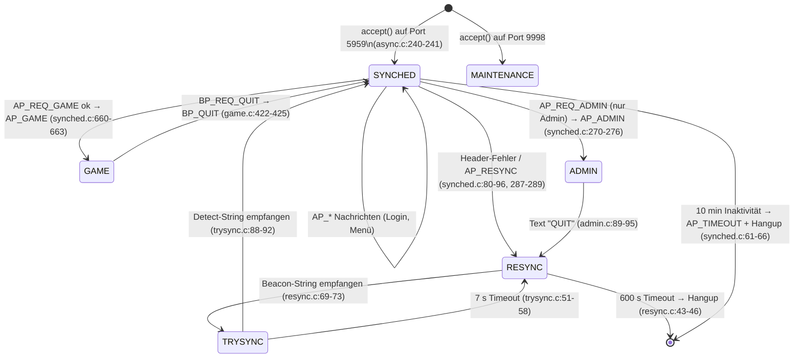
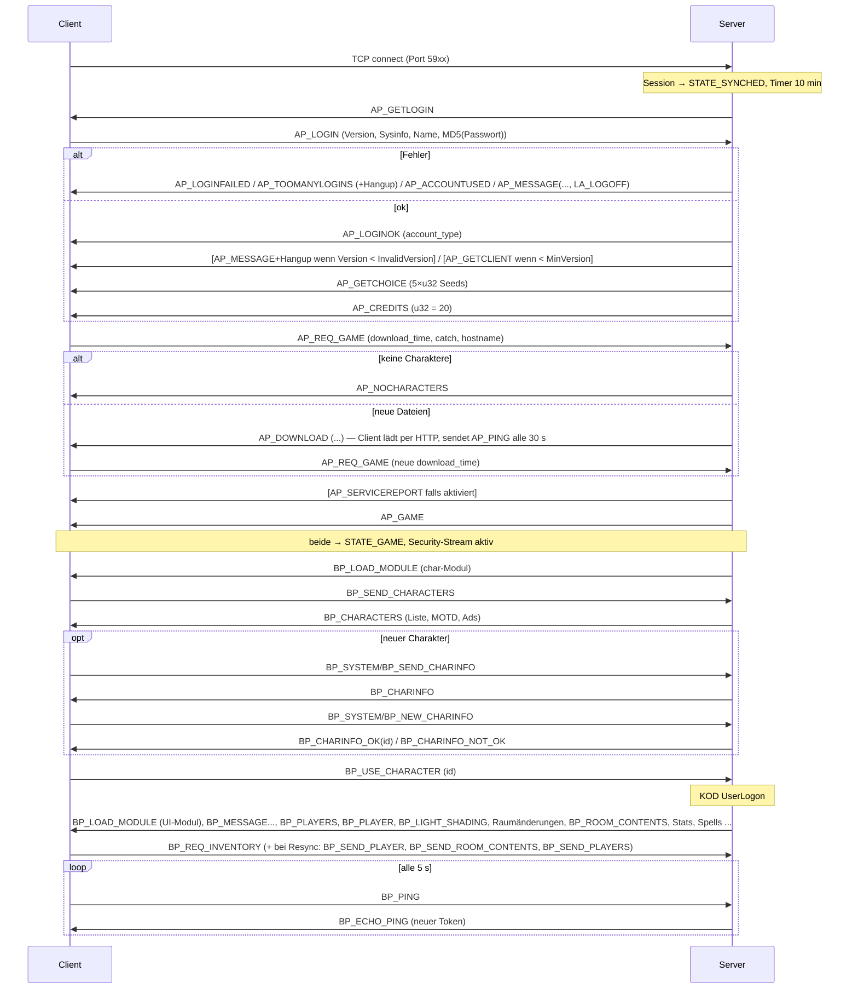

# Meridian 59 – Client/Server-Netzwerkprotokoll

Analyse des Original-C-Codes (Branch `game`, Server `blakserv/`, Client `clientd3d/`, Client-Module `module/`, Server-Logik in Blakod `kod/`).
Ziel: genügend präzise Beschreibung, um einen kompatiblen Server (gegen den Original-Client) bzw. Client (gegen den Original-Server) zu bauen.

**Maßgeblich ist der Code.** Wo `doc/protocol.txt` / `doc/login.txt` abweichen, ist das in Abschnitt 8 gesammelt und an der jeweiligen Stelle mit **⚠ Abweichung Doku** markiert.

Konventionen in diesem Dokument:

| Kürzel | Bedeutung |
|---|---|
| `u8/i8` | 1 Byte unsigned/signed |
| `u16/i16` | 2 Byte, **Little Endian** |
| `u32/i32` | 4 Byte, **Little Endian** |
| `str` | `u16 len` + `len` Bytes, **ohne** Nullterminator |
| `id` | `u32` Objekt-ID (obere 4 Bit = Tag, untere 28 Bit = ID) |
| `rsc` | `u32` Ressourcen-ID |
| C→S / S→C | Client→Server / Server→Client |

Quellenverweise im Format `pfad/datei.c:zeile`, relativ zum Repo-Root.

---

## 1. Überblick

### 1.1 Transport

- **TCP/IPv4**, ein einziger Stream pro Session, kein UDP. Socket wird mit `SOCK_STREAM` geöffnet (`blakserv/async.c:95`, `clientd3d/com.c:68`).
- **Spiel-Port Server:** Konfig `[Socket] Port`, Default **5959** (`blakserv/config.c:66`). Listen-Backlog 5 (`blakserv/async.c:143`).
- **Maintenance-Port:** `[Socket] MaintenancePort`, Default **9998**, reiner Text-Admin-Kanal, nur von IPs gemäß `MaintenanceMask` (`blakserv/config.c:67-68`, `blakserv/async.c:209-217`, `blakserv/async.c:272-326`). Nicht Teil des Client-Protokolls.
- **Client-Port:** Wenn kein `SockPort` in der INI steht, wird er aus der Servernummer gebildet: `"59%.2d" % (servernum % 100)` → Server 101 → 5901, 102 → 5902 (`clientd3d/config.c:135`, `clientd3d/config.c:631-655`). Hostname aus `DomainFormat` (Default `meridian%d.meridian59.com`) (`clientd3d/config.c:134`, `clientd3d/config.c:622-625`).
  → Für einen neuen Server: entweder auf 59xx lauschen oder den Client mit festem `SockPort` konfigurieren.
- `TCP_NODELAY` wird nur gesetzt, wenn `[Socket] Nagle = No` (Default `Yes`, d. h. Nagle bleibt **an**) (`blakserv/config.c:70`, `blakserv/async.c:119-128`).
- **Byte-Order:** Alle Mehrbyte-Felder werden per `memcpy` nativer x86-Werte geschrieben → **Little Endian** (z. B. `blakserv/commcli.c:121-129`, `clientd3d/protocol.c:97-101`, `clientd3d/server.c:165-169`). Einzige Ausnahme: Portnummer im `sockaddr` (`htons`).
- Keine TLS/Kompression. Die einzige „Verschlüsselung“ ist eine Obfuskation (Abschnitt 2.4/2.5).

### 1.2 Zustandsmaschine Server (pro Session)

States: `STATE_ADMIN, STATE_GAME, STATE_TRYSYNC, STATE_SYNCHED, STATE_RESYNC, STATE_MAINTENANCE` (`blakserv/session.h:35-36`).



Wichtig (**⚠ Abweichung Doku**, `doc/login.txt:4-14`): Beim **ersten Verbindungsaufbau gibt es keinen Beacon-Handshake**. Der Server setzt neue Sessions direkt in `STATE_SYNCHED` (`blakserv/async.c:238-242`) und schickt sofort unaufgefordert `AP_GETLOGIN` (`blakserv/synched.c:44-48`). Der Client geht nach erfolgreichem `connect()` direkt in `STATE_LOGIN` (`clientd3d/statconn.c:35-46`). Die Beacon-Strings werden nur zur **Resynchronisation** nach Fehlern benutzt (`clientd3d/statstrt.c:12-13`).

Innerhalb von `STATE_GAME` gibt es Unterzustände `GAME_NORMAL`, `GAME_BEACON`, `GAME_FINAL_SYNC` (`blakserv/game.h:16`) für die In-Game-Resynchronisation (Abschnitt 3.6). Außerdem ist eine GAME-Session entweder „Charakterwahl“ (`object_id == INVALID_OBJECT`) oder „im Spiel“ (`blakserv/session.c:223-234`).

### 1.3 Zustandsmaschine Client

Client-Hauptzustände (`clientd3d/winmsg.c`): `STATE_OFFLINE → STATE_CONNECTING → STATE_LOGIN → (STATE_DOWNLOAD) → STATE_GAME`; `STATE_STARTUP` = Resync im Login-Modus (`clientd3d/winmsg.c:53`), `STATE_TERM` = Admin-Textterminal (`clientd3d/server.c:1663-1669`).
Game-Unterzustände u. a. `GAME_INVALID`, `GAME_PLAY`, `GAME_RESYNC` (`clientd3d/statgame.c:96-148`). Der Client wählt seine Handler-Tabelle nach Zustand (`clientd3d/server.c:519-552`):

| Client-State | Tabelle | Eingangsverarbeitung |
|---|---|---|
| `STATE_CONNECTING` | leer | gerahmt |
| `STATE_LOGIN`, `STATE_DOWNLOAD` | `login_handler_table` (AP_*) | gerahmt (Download: Bytes werden verworfen, `clientd3d/com.c:525-529`) |
| `STATE_GAME` | Module zuerst, dann `game_handler_table` (BP_*) | gerahmt; in `GAME_RESYNC` rohe Bytes |
| `STATE_STARTUP`, `STATE_TERM` | – | rohe Bytes |

---

## 2. Paket-Framing

### 2.1 Header (7 Byte) – beide Richtungen

Jede Nachricht in `STATE_SYNCHED` und `STATE_GAME` (Server) bzw. `STATE_LOGIN`/`STATE_GAME` (Client) hat diesen Rahmen (`blakserv/session.h:29-31`, `blakserv/blakserv.h:183-190`, `clientd3d/server.h:15-17`, `clientd3d/com.c:226-255`):

| Offset | Typ | Feld | Bedeutung |
|---|---|---|---|
| 0 | u16 | `len` | Länge des Payloads in Bytes (inkl. Message-Type-Byte, ohne Header) |
| 2 | u16 | `crc` | siehe 2.2 – Bedeutung richtungsabhängig |
| 4 | u16 | `len_verify` | Kopie von `len` |
| 6 | u8 | `seqno` / Epoch | 0 im Login-/Synched-Modus, GC-Epoche (1..255) im Game-Modus |
| 7 | u8 | Message-Type | `AP_*` oder `BP_*` (ggf. obfuskiert, 2.5) |
| 8.. | … | Payload-Rest | |

Header-Prüfung:

- **Server, Synched:** `len != len_verify` **oder** `seqno != 0` → sendet `AP_RESYNC`, Wechsel nach `STATE_RESYNC` (`blakserv/synched.c:80-86`). `len > 6000` (`LEN_MAX_CLIENT_MSG`, `blakserv/blakserv.h:87`) ebenso (`blakserv/synched.c:88-96`). CRC wird **nicht** geprüft (`#if 0`, `blakserv/synched.c:102-111`). Nachrichten mit `len == 0` werden ignoriert (`blakserv/synched.c:143-144`).
- **Server, Game:** `len != len_verify` oder `len > 6000` → In-Game-Resync (`blakserv/game.c:151-167`). Dann Security-Prüfung des `crc`-Felds (2.4). Danach: `seqno != aktuelle Epoche` → Nachricht wird **still verworfen** (`blakserv/game.c:205-209`).
- **Client:** `len != len_verify` oder `len > 40000` (`COMBUFSIZE`, `clientd3d/com.h:17`) → Resync (`clientd3d/com.c:412-425`). CRC wird **nicht** geprüft (`#if 0`, `clientd3d/com.c:431-439`). Das Epoch-Byte jeder empfangenen Nachricht wird gespeichert und im Game-Modus in alle eigenen Nachrichten zurückgespiegelt (`clientd3d/com.c:409-410`, `clientd3d/com.c:252-254`).

Maximalgrößen:

| Grenze | Wert | Quelle |
|---|---|---|
| C→S Payload (Server-Annahme) | 6000 | `blakserv/blakserv.h:87` |
| C→S Sendepuffer Client (ungeprüft!) | 5000 | `clientd3d/protocol.c:87` |
| S→C Payload (Client-Annahme) | 40000 (sonst Resync) | `clientd3d/com.h:17`, `clientd3d/com.c:420-425` |
| S→C Payload technisch | 65535 (u16, Server prüft nicht) | `blakserv/session.c:936` |
| Server-Puffergröße | 10000 + 7 Byte Header-Prebuffer | `blakserv/session.h:42`, `blakserv/bufpool.c:74-77` |
| Strings vom Client (temp string) | auf 4000 gekappt | `blakserv/parsecli.c:229-232` |
| Strings im Client (Messages) | 4096 | `clientd3d/server.h:19` |

### 2.2 Das `crc`-Feld

| Richtung / Modus | Inhalt | Geprüft? |
|---|---|---|
| S→C (immer) | `CRC32(payload) & 0xFFFF` | Nein (`clientd3d/com.c:431-439`) |
| C→S Login (`STATE_LOGIN`) | **uninitialisierter Stackwert** (`randnum` wird nur im Game-Modus gesetzt) | Nein |
| C→S Game | Security-Hash (2.4) | Ja |

Quellen: `blakserv/session.c:796-817` (einzelner Puffer), `blakserv/session.c:897-954` (Pufferliste), `clientd3d/com.c:218-243`.

**CRC-Algorithmus** (`util/crc.c:79-91`, `blakserv/session.h:191-194`, `clientd3d/util.c:651-655`): Standard-CRC-32 (IEEE 802.3, reflektiert, Polynom 0xEDB88320, Init 0xFFFFFFFF, Final-XOR 0xFFFFFFFF – identisch zu zlib `crc32()`), davon die unteren 16 Bit.

Hinweis: `SendGameClient` enthält `assert(seqno>255);` (`blakserv/session.c:810`), was für jeden gültigen Wert fehlschlagen müsste – nur in Builds ohne `NDEBUG` relevant; der gebräuchliche Sendepfad ist ohnehin `SendGameClientBufferList`.

### 2.3 Epoche (`seqno`)

- Server-Global `epoch`, Start 1 (`blakserv/session.c:57`), wird bei jeder Garbage Collection erhöht, 0 wird übersprungen (`blakserv/session.c:89-94`, `blakserv/garbage.c:89`).
- S→C: Synched-Nachrichten `seqno = 0`, Game-Nachrichten `seqno = epoch` (`blakserv/session.c:780-787`, `blakserv/session.c:881-888`).
- C→S: Client schickt im Login-Modus 0, sonst das zuletzt empfangene Epoch-Byte (`clientd3d/com.c:252-254`).
- Zweck: Nach GC ändern sich Objekt-IDs; Client-Nachrichten mit alter Epoche werden verworfen (`blakserv/game.c:205-209`). Bei GC sendet die KOD-Logik `BP_WAIT` vorher und `BP_INVALIDATE_DATA` + `BP_UNWAIT` nachher (`kod/object/active/holder/nomoveon/battler/player/user.kod:2142-2176`).
- **Wichtig:** Auch verworfene (falsche Epoche) Nachrichten haben den Security-Stream bereits weitergeschaltet (Step vor dem Epoch-Check, `blakserv/game.c:175-209`) – der Client schaltet ebenfalls bei jedem Senden weiter, also bleibt das konsistent.

### 2.4 C→S Security-Hash im Game-Modus (Anti-Spoofing)

Initialisierung: Mit jedem `AP_GETCHOICE` schickt der Server 5 neue 32-Bit-Seeds (`blakserv/synched.c:552-570`); der Client übernimmt sie (`clientd3d/server.c:1679-1693`, `clientd3d/com.c:539-547`). Seeds werden nur in `STATE_GAME` (Client) bzw. für jede vollständig gelesene Game-Nachricht (Server) weitergeschaltet.

Pseudocode (beide Seiten identisch; `blakserv/game.c:238-250`, `clientd3d/com.c:553-565`):

```c
uint32 seeds[5];                 // aus AP_GETCHOICE, unsigned 32-bit Arithmetik (Overflow wrap!)

uint32 step() {
    for (i = 0; i < 5; i++)
        seeds[i] = (seeds[i] * 9301 + 49297) % 233280;   // erst *,+ mod 2^32, dann %
    return seeds[ seeds[4] % 4 ];                        // nur Streams 0..3 wählbar
}

uint16 security(payload, len) {                 // payload[0] = Message-Type
    uint16 h = (uint16) step();
    h ^= len;                                   // Payload-Länge
    h ^= (uint16)((int16)(int8)payload[0] << 4);// ACHTUNG: Type-Byte vorzeichenbehaftet erweitert!
    h ^= (uint16)(CRC32(payload, len) & 0xFFFF);
    return h;                                   // steht im Header-Feld "crc"
}
```

Die Vorzeichenerweiterung ist auf beiden Seiten gleich: Client `temp = (WORD) msg[0]` mit `const char *msg` (`clientd3d/com.c:238-241`), Server `((unsigned int)msg.data[0] << 4)` mit `char data[]` (`blakserv/game.c:179-181`). Relevant für C→S-Codes ≥ 0x80, z. B. `BP_USERCOMMAND` (155), `BP_REQ_DEPOSIT` (230), `BP_REQ_WITHDRAWAL*` (232/233), `BP_REQ_GET_FROM_CONTAINER` (239): hier muss ein Re-Implementierer `0xFF00 | b` vor dem Shift verwenden.

Server-Verhalten bei Mismatch (`blakserv/game.c:185-203`): einmalig `seeds_hacked = true`; Log (Konfig `LogSpoofs`, Default Yes) und **Hangup** (`HangupSpoofs`, Default Yes) (`blakserv/config.c:194-195`); zusätzlich 10× `BP_RESYNC` und In-Game-Resync. Ist `seeds_hacked` gesetzt, wird nie wieder geprüft.

### 2.5 S→C Obfuskation des Message-Type-Bytes („Secure Token“ / „Redbook“)

Nur das **erste Payload-Byte** (Message-Type) jeder gerahmten S→C-Nachricht wird verändert. Server: `SecurePacketBufferList` (`blakserv/commcli.c:139-179`), aufgerufen von `SendPacket`/`SendCopyPacket` (`blakserv/commcli.c:181-203`) und beim Admin-Text (`blakserv/adminfn.c:597-601`). Client: `DesecureByServerToken`, für **jede** empfangene gerahmte Nachricht in jedem Zustand (`clientd3d/server.c:493-511`, `clientd3d/server.c:524`).

Server wendet es nur an, wenn die Session einen Account hat (`account_id != 0`), keine Konsole ist und `version_major >= 4` (`blakserv/commcli.c:144-153`). Vor erfolgreichem Login (Account = NULL) also nie.

```c
// Zustand je Session: uint32 token = 0; const char *slide = NULL; (session.c:152-153 / server.c:115-130)
void secure_or_desecure(uint8 *type_byte) {
    *type_byte ^= (uint8)(token & 0xFF);
    if (slide) {
        token += (*slide & 0x7F);
        slide++;
        if (*slide == '\0') slide = redbook_string;      // zyklisch
    }
}
```

Neuer Token per **`BP_ECHO_PING`** (Antwort auf `BP_PING`, oder unaufgefordert nach GC/Reload via `UpdateSecurityRedbook`) (`blakserv/game.c:371-404`, `blakserv/game.c:780-823`):

1. Server: `new = seeds[0] & 0xFF` (aktueller C→S-Stream-Zustand).
2. Server sendet `BP_ECHO_PING, u8 (new ^ 0xED), u32 redbook_rsc_id` – diese Nachricht wird noch mit dem **alten** Token obfuskiert.
3. Danach setzt der Server `token = new`, `slide = Anfang des Redbook-Strings`.
4. Client: entschlüsselt mit altem Token, liest `ch`, setzt `token = ch ^ 0xED`, lädt Redbook-String per Ressourcen-ID aus seinen lokalen `.rsc`-Dateien, `slide = Stringanfang` (`clientd3d/server.c:1607-1631`, `clientd3d/server.c:132-150`).

Redbook-String: Server nimmt den Wert der Ressource mit Namen aus `[Security] RedbookRsc` (Default `system_success_rsc`, `blakserv/config.c:196`). Ist keine Ressource vorhanden (ID 0) oder kennt der Client die ID nicht, verwenden beide den Default **`"BLAKSTON: Greenwich Q Zjiria"`** (`blakserv/game.c:825-831`, `clientd3d/server.c:152-158`).
Bis zum ersten `BP_ECHO_PING` ist `token = 0`, `slide = NULL` → keine Veränderung. Der Client setzt den Token nur bei neuer Verbindung zurück (`clientd3d/statconn.c:19-22`), der Server bei Session-Allokation (`blakserv/session.c:152-153`). Nach `BP_REQ_QUIT` (zurück ins Menü) laufen beide Token-Zustände weiter und gelten auch für die dann folgenden `AP_*`-Nachrichten.

**Hinweis für einen neuen Server:** `BP_ECHO_PING` mit `ch = 0xED` (→ Token 0) und `id = 0` setzt zwar den Token auf 0, aktiviert aber den Sliding-Token mit dem Default-Redbook, sodass der Token danach wandert. Die Logik muss also sauber implementiert werden (ist aber trivial).

Nicht obfuskiert werden: Rohbytes im Admin-/Resync-Modus (`tell_cli_str`, Text) – sie laufen über `SendBytes` (`blakserv/session.c:788-792`, `blakserv/game.c:336`).

### 2.6 Server-seitige Sende-Queue (Implementierungsdetail mit Protokollwirkung)

- Ist ein Socket nicht sofort beschreibbar, werden Puffer in `send_list` gequeued; bei mehr als 20 gequeueten Puffern wird jede weitere Nachricht **verworfen** (`blakserv/session.h:43`, `blakserv/session.c:1046-1053`). Da der Secure-Token für diese Nachricht schon weitergeschaltet wurde, desynchronisiert das die Obfuskation.
- Teil-Sends werden nicht korrekt behandelt (nur geloggt, Rest verworfen) (`blakserv/async.c:459-466`; `send()`-Rückgabewert ignoriert in `blakserv/session.c:840`, `blakserv/session.c:985`).

---

## 3. Verbindungsaufbau und Login

### 3.1 Sequenz (Normalfall)



### 3.2 Login-Details

**AP_LOGIN** wird vom Client erst als Antwort auf `AP_GETLOGIN` gesendet (`clientd3d/server.c:1671-1677`, `clientd3d/login.c:62-80`). Layout siehe 5.1. Server-Logik (`blakserv/synched.c:163-218`, `blakserv/synched.c:321-424`):

1. Mindestlänge 39 Byte (Type + feste Felder), Name < 51, Passwort < 33 Byte (`blakserv/synched.c:164`, `blakserv/blakserv.h:22-23`).
2. Account-Suche case-insensitiv nach Name (`blakserv/account.c:397-416`).
3. Passwortvergleich: `account->password` (std::string) `!=` empfangene Bytes – **byteweiser Vergleich des MD5-Digests** (`blakserv/synched.c:330`).
4. Fehlversuch: Zähler; bei `MaxAttempts` (Default 3) → `AP_TOOMANYLOGINS` + Hangup, sonst `AP_LOGINFAILED` (`blakserv/synched.c:330-344`, `blakserv/config.c:80`).
5. Optional Limit pro IP (`MaxPerIPAddress`, Default 0=aus) → `AP_MESSAGE`+`LA_LOGOFF` (`blakserv/synched.c:347-364`).
6. Gesperrt → `AP_MESSAGE`+`LA_LOGOFF` (`blakserv/synched.c:367-375`).
7. Account schon online: bei `[Inactive] Override=Yes` (Default) wird die **alte** Session gekickt, sonst `AP_ACCOUNTUSED` (`blakserv/synched.c:382-402`, `blakserv/config.c:101`).
8. Server voll (Session-Index ≥ `MaxActive`) und kein Admin/DM → `AP_MESSAGE`+`LA_LOGOFF`+Hangup (`blakserv/synched.c:405-413`).
9. `VerifyLogin`: `AP_LOGINOK` mit `u8 account->type`; dann Versionscheck `major*100+minor` gegen `InvalidVersion` (Default 100 → Hangup mit Text) und `MinVersion` (Default 0 → `AP_GETCLIENT`), sonst Menü (`blakserv/synched.c:434-475`, `blakserv/config.c:81-87`). Aktueller Client: 7.37 → 737 (`clientd3d/client.h:49-50`).

**Passwort-Hashing** (`util/md5.c:301-315`, `include/md5.h:32`, `clientd3d/login.c:68-70`): `digest = MD5(passwort_ohne_NUL)` (16 Byte), anschließend **jedes 0x00-Byte im Digest durch 0x01 ersetzen**. Diese 16 Byte werden als `str` (Länge 16) übertragen. Der Server speichert genau diesen Digest (`blakserv/account.c:266-273`). Kein Salt, keine Challenge – Replay-fähig.

**Account-Typ** in `AP_LOGINOK`: Server `ACCOUNT_NORMAL=0, ADMIN=1, DM=2, GUEST=3` (`blakserv/account.h:16`); Client interpretiert `USER_NORMAL=0, USER_ADMIN=1, USER_GUEST=2` (`clientd3d/login.h:21`) → **ein DM wird vom Client als Gast interpretiert** (nur für `admin_mode` relevant, `clientd3d/login.c:216`).

**Menü (`SynchedDoMenu`)**: `AP_GETCHOICE` + 5 Seeds, dann `AP_CREDITS` mit festem Wert 20 (`blakserv/synched.c:536-570`). Der Client initialisiert die Streams und ruft sofort `EnterGame()` → `AP_REQ_GAME` (oder `AP_REQ_ADMIN`, nur in `ADMIN_BUILD` und mit gedrückter Strg-Taste) (`clientd3d/server.c:1679-1693`, `clientd3d/login.c:211-226`, `clientd3d/protocol.h:52-58`).

**AP_REQ_GAME** (`blakserv/synched.c:222-269`): erneuter Check `MinVersion` (→ `AP_MESSAGE` + `LA_LOGOFF`), Spiel gesperrt (nur Admin/DM) → `AP_MESSAGE`. Dann `SynchedGotoGame` (`blakserv/synched.c:572-664`). Das Feld `catch` (= `(737*3)+3`, `clientd3d/login.c:224`, `clientd3d/client.h:68`) und der Hostname werden gelesen, aber **nicht verwendet**.

### 3.3 Update-/Download-Mechanismus

- Der Client schickt in `AP_REQ_GAME` den Zeitstempel seines letzten erfolgreichen Downloads (`clientd3d/config.c:569-588`).
- Server führt eine nach Zeit sortierte Liste der Paketdateien (`blakserv/dllist.c:48-80`); alle mit `time > last_download_time` werden in `AP_DOWNLOAD` gelistet (`blakserv/dllist.c:142-177`, `blakserv/synched.c:595-630`). Während des Downloads Timeout `[Inactive] Transfer` (2 min) (`blakserv/synched.c:628`, `blakserv/config.c:97`).
- Client: Dialog, dann **HTTP-GET** (WinInet, `INTERNET_SERVICE_HTTP`) von `http://<machine><path><filename>` (`clientd3d/transfer.c:79-141`) – **⚠ Abweichung Doku**: nicht FTP. Archive werden entpackt (`clientd3d/download.c:640-655`). Pro fertiger Datei wird `download_time = file.time` gespeichert (`clientd3d/download.c:344`, `clientd3d/download.c:393-396`). Während des Downloads alle 30 s `AP_PING` (`clientd3d/download.c:40`, `clientd3d/download.c:663-677`). Danach erneut `AP_REQ_GAME` (`clientd3d/download.c:100-108`).
- Datei-Flags: Bits 0-1 Kommando (0=holen, 1=löschen), Bits 2-4 Zielverzeichnis, `0x20` Gast (`include/proto.h:456-471`).
- `AP_GETCLIENT` (Client-Update) bekommt Host + Dateiname (`blakserv/synched.c:458-469`, `clientd3d/server.c:1870-1886`).
- Ein neuer Server kann den Download-Mechanismus deaktivieren, indem er keine Dateien listet (dann direkt `AP_GAME`).

### 3.4 Charakterwahl und Spieleintritt

- Bei Eintritt in `STATE_GAME` ruft der Server das KOD-Systemobjekt (`SYSTEM_ENTER_GAME_MSG` = KOD `SystemLogon`) auf, das `BP_LOAD_MODULE(system_char_module)` sendet (`blakserv/game.c:52-65`, `blakserv/game.c:612-626`, `kod/util/system.kod:3722-3728`). Timeout für die Charakterwahl: `[Inactive] SelectChar` = 10 min (`blakserv/game.c:58`, `blakserv/config.c:98`).
- Das Client-Modul `char` fordert beim Laden `BP_SEND_CHARACTERS` an (`module/char/char.c:62-72`). Der **Server-C-Code** (nicht KOD) beantwortet das mit `BP_CHARACTERS` (`blakserv/game.c:488-490`, `blakserv/game.c:550-610`).
- `BP_USE_CHARACTER(id)`: Server prüft, dass das Objekt zum Account gehört, und ruft KOD `UserLogon` (`USER_ENTER_GAME_MSG`) (`blakserv/game.c:437-449`, `blakserv/game.c:532-548`). Ab jetzt läuft der Credit-/Inaktivitäts-Timer im Sekundentakt.
- KOD `UserLogon` (`kod/object/active/holder/nomoveon/battler/player/user.kod:582-645`) lädt das UI-Modul, schickt Begrüßung, `BP_PLAYERS`, setzt Position (→ `BP_PLAYER`, Raum-Inhalt etc.).
- `BP_PLAYER` löst beim Client das Laden der `.roo`-Datei aus; der Client prüft `room_security` gegen den Wert aus der `.roo`-Datei (untere 28 Bit) und blendet bei Mismatch Spieler aus (blind/paralysiert) (`clientd3d/game.c:247-308`). **Für einen neuen Server: `room_security` muss zur Roo-Datei des Clients passen.**
- Nach `BP_ROOM_CONTENTS` ist der Client in `GAME_PLAY` (`clientd3d/game.c:380-405`).
- Der Client fordert in `ResetUserData` immer `BP_REQ_INVENTORY` an, bei Resync/Invalidate zusätzlich `BP_SEND_PLAYER`, `BP_SEND_ROOM_CONTENTS`, `BP_SEND_PLAYERS` (`clientd3d/game.c:83-123`).

### 3.5 Resync im Login-Modus (Beacon-Handshake)

Strings (`blakserv/resync.c:24`, `blakserv/trysync.c:28-31`, `clientd3d/statstrt.c:27-29`):

| Name | Bytes (dezimal) | Richtung |
|---|---|---|
| beacon (`client_string1`) | `1 255 66 76 65 75 10 13 2` („\x01\xFF BLAK \n\r \x02“) | C→S, roh |
| tell_cli (`server_string`) | `3 251 98 108 97 107 10 13 1` („\x03\xFB blak \n\r \x01“) | S→C, roh |
| detect (`client_string2`) | `7 230 98 108 97 107 10 13 8` | C→S, roh |

Ablauf: Client erkennt Fehler (`clientd3d/com.c:364-381`) oder erhält `AP_RESYNC` → sendet (gerahmt) `AP_RESYNC`, wechselt nach `STATE_STARTUP` und schickt den Beacon roh, alle 2 s, max. 60 s (`clientd3d/statstrt.c:22-23`, `clientd3d/statstrt.c:47-77`). Server in `STATE_RESYNC` sucht den Beacon byteweise (`blakserv/resync.c:66-78`) → `STATE_TRYSYNC`: sendet `tell_cli` roh, wartet max. 7 s auf `detect` (`blakserv/trysync.c:37-45`, `blakserv/trysync.h:16`); Timeout → schickt absichtlich Müll („aoeuaoeuaoeutha“) und zurück nach RESYNC (`blakserv/trysync.c:51-58`). Client sucht `tell_cli` im Bytestrom, schickt `detect` und geht nach `STATE_LOGIN` (`clientd3d/statstrt.c:82-125`). Server → `STATE_SYNCHED`; da Account bekannt, sofort Menü (`AP_GETCHOICE` mit neuen Seeds) (`blakserv/synched.c:44-54`).

### 3.6 Resync im Game-Modus

- Server erkennt Fehler (Header/Security) → sendet **10× gerahmtes `BP_RESYNC`** und geht in `GAME_BEACON` (`blakserv/game.c:252-271`).
- Client erhält `BP_RESYNC` (oder erkennt selbst Fehler und sendet gerahmtes `BP_RESYNC`) → `GAME_RESYNC`, startet Beacon (`clientd3d/server.c:1851-1859`, `clientd3d/com.c:375-379`, `clientd3d/statgame.c:141-142`). In `GAME_RESYNC` werden alle eingehenden Bytes roh an die Beacon-Erkennung gegeben (`clientd3d/com.c:457-469`).
- Server: Beacon erkannt → `tell_cli` roh, `GAME_FINAL_SYNC`; danach muss exakt `detect` folgen, jedes falsche Byte → erneut 10× `BP_RESYNC` (`blakserv/game.c:295-349`). Erfolg → `GAME_NORMAL`; war noch kein Charakter gewählt, wird `SystemLogon` erneut ausgelöst (`blakserv/game.c:285-291`).
- Client nach Erfolg: `ResetUserData()` (fordert Player/Room/Players/Inventory neu an) (`clientd3d/statstrt.c:120-123`).
- Security-Seeds werden dabei **nicht** neu initialisiert; beide Seiten haben für jede gerahmte Nachricht weitergeschaltet.

---

## 4. Datenformate

### 4.1 Primitive

| Typ | Größe | Kodierung / Bemerkung | Quelle |
|---|---|---|---|
| Message-Type | 1 | `u8` | `include/proto.h:506` |
| `str` | 2+n | `u16` Länge + Bytes, kein NUL. Zeichensatz: Windows-ANSI (keine Konvertierung im Code) | `blakserv/commcli.c:131-137`, `clientd3d/protocol.c:109-116`, `clientd3d/server.c:469-485` |
| `id` (Objekt) | 4 | Bits 0-27 Objekt-Nr., Bits 28-31 Tag. Tag 0 = normal, Tag 1 = `CLIENT_TAG_NUMBER` (Mengenobjekt, es folgt ein zusätzliches `u32 amount`) | `include/proto.h:283`, `clientd3d/object.h:22-24`, `include/bkod.h:211-215` |
| `rsc` | 4 | Ressourcen-ID; der Client löst sie über lokale `.rsc`-Dateien zu Strings/Dateinamen auf; dynamische Ressourcen per `BP_CHANGE_RESOURCE` | `clientd3d/server.c:1412-1430` |
| Ganzzahl KOD | 1/2/4 | KOD-Werte sind 28-Bit-signed; bei 1/2 Byte trunkiert. Server liest C→S-1-Byte-Werte als **signed char**, 2-Byte als **signed short** | `blakserv/commcli.c:71-84`, `blakserv/parsecli.c:252-268` |
| Koordinate | 2 | `u16`, KOD-Feinkoordinate: `zeile_oder_spalte * 64 + fein (0..63)`, Zeilen/Spalten **1-basiert** (64 Einheiten pro Gridfeld). Client: `client_fine = (wert - 64) << 4` (1024 Einheiten/Feld) | `clientd3d/server.c:176-184`, `clientd3d/drawdefs.h:52-57`, `kod/.../user.kod:6229-6231` |
| Koordinatenpaar | 4 | **zuerst Zeile (y), dann Spalte (x)** | `clientd3d/server.c:180-183`, `clientd3d/protocol.h:74-76` |
| Winkel | 2 | 0..4095 = 360° (`MAX_ANGLE` 4096); Client nutzt ebenfalls 4096 | `include/proto.h:303`, `clientd3d/drawdefs.h:16`, `clientd3d/game.h:21-24` |
| Licht | 1 | 0..255 (KOD bindet auf 0..255; Doku sagt 0..64) | `kod/.../user.kod:2469` |
| Liste | 2+… | `u16` Anzahl, dann Elemente | `include/proto.h:509` |
| Zeit | 4 | `u32`, Sekunden (Mail/News siehe Doku `doc/protocol.txt:633-635`) | `include/proto.h:526` |

KOD-Spezialgrößen bei `AddPacket` (`blakserv/commcli.c:20-21`, `blakserv/commcli.c:53-112`): Ein Wert vom Typ String wird **immer** als `str` geschrieben (Größenangabe ignoriert); Größe 5 = `NUMBER_OBJECT` (ID mit Tag 1); Größe 6 = `STRING_RESOURCE` (Ressource wird als ihr Stringwert `str` gesendet).

### 4.2 Animation (`animation`) und optionale Palette/Effekt-Präfixe

```
animation :=
  u8 type
  type = ANIMATE_NONE (1):  u16 group                       // 1-basiert
  type = ANIMATE_CYCLE (2): u32 period_ms, u16 low, u16 high
  type = ANIMATE_ONCE (3):  u32 period_ms, u16 low, u16 high, u16 final
```
(`clientd3d/server.c:222-261`, `include/proto.h:289-300`). Bitmap-Gruppen sind serverseitig 1-basiert (`clientd3d/server.h:24`). Unbekannter Typ → Client liest nichts weiter (Stream danach verschoben).

**Optionales Präfix** vor jeder Animation an folgenden Stellen: im Objekt-Deskriptor, im Overlay, in der Bewegungsanimation von Raumobjekten/`BP_CHANGE`, im Background-Overlay und in `BP_SHOOT` (`clientd3d/server.c:191-216`):

```
[ u8 9 (ANIMATE_TRANSLATION), u8 xlat ]   oder   [ u8 10 (ANIMATE_EFFECT), u8 effect ]
```
Der Client peekt das nächste Byte; ist es 9 oder 10, wird es samt Folgebyte konsumiert, sonst nicht. Danach folgt die eigentliche `animation`. (Es kann jeweils nur **ein** Präfix vorkommen.)

### 4.3 Overlays

```
overlays := u8 count, overlay[count]
overlay  := rsc icon, i8/u8 hotspot, [Präfix], animation
```
(`clientd3d/server.c:267-298`). Hotspot 1..9 = Bildschirmpunkte für Player-Overlays, für Objekt-Overlays Hotspot-Nr. im Bitmap; laut Doku < 0 = unter dem Objekt zeichnen.

### 4.4 Dynamisches Licht (`dlight`)

```
dlight := u16 flags; falls flags != 0: u8 intensity, u16 color
```
(`clientd3d/server.c:300-313`, Flags `include/proto.h:540-543`). KOD-Default: `AddPacket(2,0)` (`kod/object.kod:510-516`).

### 4.5 Objekt-Deskriptor (`object_desc`)

**⚠ Abweichung Doku** (`doc/protocol.txt:769-785`): Rarity und Licht fehlen dort.

```
object_desc :=
  id      obj_id                    // Tag 1 → es folgt amount
  [u32    amount]                   // nur wenn (obj_id >> 28) == 1
  rsc     icon
  rsc     name
  u32     flags                     // OF_*, PF_*, Zeichen-Effekte, s. include/proto.h:357-411
  u32     rarity                    // item_rarity_grade (include/proto.h:496-503)
  dlight                            // NUR in der Variante "mit Licht" (Default)
  [Präfix]                          // Palette/Effekt
  animation
  overlays
```
Quellen: `clientd3d/server.c:319-352`, KOD-Gegenstück `ToCliObject` (`kod/object/active/holder/nomoveon/battler/player/user.kod:2324-2455`).
Die Variante **ohne `dlight`** wird nur für `BP_PLAYER_OVERLAY` verwendet (`clientd3d/server.c:1440`, `kod/object/active/holder/nomoveon/battler/player.kod:8410-8418`).

Listen: `object_list := u16 n, object_desc[n]`; der Client verlangt, dass die Liste exakt bis Nachrichtenende reicht (`clientd3d/server.c:414-437`).

### 4.6 Raum-Objekt (`room_object`)

```
room_object :=
  object_desc (mit dlight)
  u16 row, u16 col                  // Koordinaten 4.1
  u16 angle
  [Präfix] animation                // Bewegungsanimation
  overlays                          // Bewegungs-Overlays
```
(`clientd3d/server.c:384-405`, KOD `kod/.../user.kod:2585-2589`, `kod/.../user.kod:6184-6191`).

### 4.7 Background-Overlay (`bg_overlay`)

```
bg_overlay := id, rsc icon, rsc name, [Präfix], animation, u16 x (Winkel), u16 y (Pixel über Horizont)
```
(`clientd3d/server.c:443-462`).

### 4.8 Server-Formatstrings (`printf`-Parameter)

Für `BP_MESSAGE`, `BP_SYS_MESSAGE`, `BP_SAID`, `BP_LOOK`, `BP_MAIL`, `BP_LOOK_NEWSGROUP` (`clientd3d/srvrstr.c:31-282`):
`rsc fmt` gefolgt von Parametern in Reihenfolge der Platzhalter im Ressourcen-String:

| Platzhalter | Wire | Bedeutung |
|---|---|---|
| `%d`, `%i` | `u32` | Ganzzahl |
| `%s` | `u32 rsc` | String-Ressource; deren eigene Platzhalter werden in einem **weiteren Durchlauf** ausgewertet, d. h. ihre Parameter folgen **nach** allen Parametern des aktuellen Durchlaufs |
| `%q` | `str` | literaler String (max. 10 pro Nachricht) |
| `%%` | – | Prozentzeichen |

Der Server muss also die Formatstrings des Clients kennen, um korrekte Parameter zu senden (KOD tut das, z. B. `kod/.../user.kod:3205-3215`).

### 4.9 Statistik (`stat`)

```
stat := u8 num (1-basiert), rsc name, u8 type,
  type = 1 (STATS_NUMERIC): u8 tag, u32 value;
                            falls tag == 1 (STAT_INT): u32 min, u32 max, u32 current_max
                            (tag == 2: value ist rsc)
  type = 2 (STATS_LIST):    id obj, u32 value, rsc icon
```
(`module/merintr/merintr.c:965-995`, `include/proto.h:309-317`, KOD `kod/.../user.kod:6686-6691`). **⚠ Abweichung Doku**: `icon` fehlt in `doc/protocol.txt:868-870`.

---

## 5. Nachrichtentypen

Codes aus `include/proto.h:16-48` (AP) und `include/proto.h:52-218` (BP). Alle Layouts beginnen nach dem Type-Byte.

### 5.1 Login-/Synched-Modus, Client → Server

Client-Tabelle `clientd3d/protocol.c:15-31`, Server-Parser `blakserv/synched.c:124-311`.

| Dez | Hex | Name | Payload | Server-Verhalten |
|---|---|---|---|---|
| 1 | 0x01 | `AP_PING` | – | nur Timer-Reset (`synched.c:303-305`) |
| 2 | 0x02 | `AP_LOGIN` | s. u. | Login (`synched.c:163-218`) |
| 3 | 0x03 | `AP_REGISTER` | `str` | an Datei angehängt (`synched.c:279-285`) |
| 4 | 0x04 | `AP_REQ_GAME` | `u32 last_download_time, u32 catch, str hostname` | `synched.c:222-269` |
| 5 | 0x05 | `AP_REQ_ADMIN` | – | nur Admin → `AP_ADMIN`, `STATE_ADMIN` |
| 6 | 0x06 | `AP_RESYNC` | – | → `STATE_RESYNC` |
| 7 | 0x07 | `AP_GETCLIENT` | – | „no longer supported“ |
| 8 | 0x08 | `AP_GETRESOURCE` | – | Client sendet, Server: „invalid packet“ |
| 9 | 0x09 | `AP_GETALL` | – | dito |
| 10 | 0x0A | `AP_REQ_MENU` | – | Menü erneut (`AP_GETCHOICE`, `AP_CREDITS`) |
| 11 | 0x0B | `AP_ADMINNOTE` | `str` | an Datei angehängt |
| 32 | 0x20 | `AP_UPLOAD` | – | Server: „invalid packet“ |

Vor erfolgreichem Login wird alles außer `AP_LOGIN` ignoriert (`blakserv/synched.c:155-159`).

**AP_LOGIN** (Gesamt-Payload inkl. Type ≥ 39 Byte + Strings) (`clientd3d/protocol.c:16-19`, `clientd3d/login.c:74-79`, `blakserv/synched.c:166-214`):

| Off. | Typ | Feld (Client) | Server-Interpretation |
|---|---|---|---|
| 1 | u8 | `MAJOR_REV` (7) | `version_major` |
| 2 | u8 | `MINOR_REV` (37) | `version_minor` |
| 3 | u32 | OS-Plattform | `os_type` |
| 7 | u32 | OS major | |
| 11 | u32 | OS minor | |
| 15 | u32 | RAM in Bytes | |
| 19 | u32 | CPU | |
| 23 | u16 | Bildschirmbreite | |
| 25 | u16 | Bildschirmhöhe | |
| 27 | u32 | `color_depth` | `displays_possible` |
| 31 | u32 | `bandwidth` | |
| 35 | u32 | `reserved` | Bits 0-7 Farbtiefe, Bits 8-15 Partner-Code |
| 39 | str | Benutzername (≤50) | |
| … | str | Passwort = 16-Byte-MD5-Digest (0→1) | |

**⚠ Abweichung Doku** (`doc/login.txt:26-38`): Doku nennt 12 reservierte Bytes; tatsächlich drei definierte `u32`. Inhalt für einen neuen Server unerheblich (nur Logging).

### 5.2 Login-/Synched-Modus, Server → Client

Client-Tabelle `clientd3d/server.c:27-47`.

| Dez | Hex | Name | Payload | Quelle Client-Parser |
|---|---|---|---|---|
| 21 | 0x15 | `AP_GETLOGIN` | – | `server.c:1671-1677` |
| 22 | 0x16 | `AP_GETCHOICE` | `u32 seed[5]` (**⚠ Doku**: ohne Payload) | `server.c:1679-1693` |
| 23 | 0x17 | `AP_LOGINOK` | `u8 account_type` | `server.c:1635-1645` |
| 24 | 0x18 | `AP_LOGINFAILED` | – | `server.c:1647-1653` |
| 25 | 0x19 | `AP_GAME` | – | `server.c:1655-1661` |
| 26 | 0x1A | `AP_ADMIN` | – (danach Rohtext) | `server.c:1663-1669` |
| 27 | 0x1B | `AP_ACCOUNTUSED` | – | `server.c:1708-1714` |
| 28 | 0x1C | `AP_TOOMANYLOGINS` | – | `server.c:1716-1722` |
| 29 | 0x1D | `AP_TIMEOUT` | – | `server.c:1724-1730` |
| 30 | 0x1E | `AP_CREDITS` | `u32` (ignoriert) | `server.c:1793-1803` |
| 31 | 0x1F | `AP_DOWNLOAD` | s. u. | `server.c:1732-1767` |
| 7 | 0x07 | `AP_GETCLIENT` | `str host, str filename` | `server.c:1870-1886` |
| 33 | 0x21 | `AP_NOCREDITS` | – (vom Server nicht mehr gesendet) | `server.c:1769-1775` |
| 34 | 0x22 | `AP_MESSAGE` | `str text, u8 action` (0 = `LA_NOTHING` → weiter ins Spiel, 1 = `LA_LOGOFF`) | `server.c:1695-1706`, `clientd3d/login.c:108-127` |
| 6 | 0x06 | `AP_RESYNC` | – | `server.c:1842-1849` |
| 35 | 0x23 | `AP_DELETERSC` | `u16 n, str[n]` | `server.c:1805-1831` |
| 36 | 0x24 | `AP_DELETEALLRSC` | – | `server.c:1833-1839` |
| 37 | 0x25 | `AP_NOCHARACTERS` | – (Client loggt aus) | `server.c:1861-1868` |
| 38 | 0x26 | `AP_GUEST` | nicht verwendet | – |
| 39 | 0x27 | `AP_SERVICEREPORT` | `str machine, str dir, str user, str password` – **Client hat keinen Handler** (wird ignoriert) | `blakserv/synched.c:633-656` |

Alle Login-Handler prüfen die exakte Länge; bei Abweichung wird die Nachricht verworfen (keine Resync).

**AP_DOWNLOAD** (`blakserv/synched.c:600-622`, `blakserv/synched.c:666-672`, `clientd3d/server.c:1732-1767`):
```
u16 num_files
str machine            // HTTP-Host
str path               // URL-Pfadpräfix
str reason             // Text im Dialog
str demo_url           // "Demo"-Button
num_files × { u32 time, u32 flags, u32 size, str filename }   // aufsteigend nach time
```
**⚠ Abweichung Doku** (`doc/login.txt:119-144`): `reason`, `demo_url` und `size` fehlen dort.

### 5.3 Game-Modus, Client → Server

Server-Parsing: einige Codes direkt in C (`blakserv/game.c:406-530`), alle anderen über die Tabellen in `blakserv/sprocket.c:22-133` an KOD (`ReceiveClient`) (`blakserv/parsecli.c:102-458`). Nicht in der Tabelle stehende Codes → „invalid command“, ignoriert (`blakserv/parsecli.c:160-164`). Ein Rest nach dem letzten Parameter wird toleriert (`blakserv/parsecli.c:412-417`).

Parameter-Kodierung (Client `clientd3d/protocol.c:206-312`):

| Client-Param | Wire | Server-Tabelle |
|---|---|---|
| `PARAM_ID` | `u32` mit **gelöschten** Tag-Bits | `{4, TAG_OBJECT}` (prüft Existenz des Objekts) |
| `PARAM_OBJECT` | `u32 id` (+ `u32 amount` wenn Tag 1); Mengenobjekte mit `amount<=0` werden ganz weggelassen | `{4, TAG_OBJECT}` + `number_stuff` |
| `PARAM_OBJECT_LIST` | `u16 n`, n × (`u32 id` [+`u32 amount`]) | `{2, LIST_OBJ_PARM}` |
| `PARAM_ID_LIST` / `PARAM_ID_ARRAY` / `PARAM_INT_ARRAY` | `u16 n`, n × `u32` | `LIST_OBJ/INT/RSC_PARM` |
| `PARAM_WORD/COORD/NEWSID` | `u16` | `{2, TAG_INT}` (signed) |
| `PARAM_BYTE/GROUP/SAY_INFO/ATTACK_INFO` | `u8` | `{1, TAG_INT}` (signed) |
| `PARAM_INT/INDEX` | `u32` | `{4, TAG_INT}` |
| `PARAM_STRING` | `str` | `{0, TAG_STRING}` bzw. `TAG_TEMP_STRING` (≤4000) |

Besonderheiten Server-Parser: Objekt-Listen kommen bei KOD in **umgekehrter** Reihenfolge an, Int/Rsc-Listen in Originalreihenfolge (`blakserv/parsecli.c:285-358`); jede referenzierte Objekt-/Ressourcen-ID muss existieren, sonst wird die ganze Nachricht verworfen.

| Dez | Hex | Name | Payload (C→S) | Behandlung | Quelle |
|---|---|---|---|---|---|
| 2 | 0x02 | `BP_RESYNC` | – | C: In-Game-Resync | `game.c:427-431` |
| 3 | 0x03 | `BP_PING` | – | C: `BP_ECHO_PING` | `game.c:433-435` |
| 5 | 0x05 | `BP_ROUNDTRIP2` | `u32` | **nicht funktional**: Client-Tabelle kennt den Code nicht (wird nie gesendet), Server-Tabelle auch nicht | `clientd3d/protocol.h:114` |
| 6 | 0x06 | `BP_SYSTEM` | `u8 subcode` + Sub-Payload | KOD System-Objekt, Tabelle `system_def_table` | `sprocket.c:74`, `sprocket.c:85-92` |
| 20 | 0x14 | `BP_LOGOFF` | – | Client sendet (`protocol.c:72`), **Server hat keinen Eintrag** → ignoriert | – |
| 23 | 0x17 | `BP_CHANGE_PASSWORD` | `str old_md5, str new_md5` (je 16 Byte Digest) | C: → `BP_PASSWORD_OK/NOT_OK` | `game.c:492-523`, `clientd3d/maindlg.c:113-117` |
| 40 | 0x28 | `BP_SEND_PLAYER` | – | KOD → `BP_PLAYER` | `sprocket.c:32` |
| 41 | 0x29 | `BP_SEND_STATS` | `u8 group` | KOD → `BP_STAT_GROUP` | `sprocket.c:45` |
| 42 | 0x2A | `BP_SEND_ROOM_CONTENTS` | – | KOD → `BP_ROOM_CONTENTS` | `sprocket.c:33` |
| 43 | 0x2B | `BP_SEND_OBJECT_CONTENTS` | `id` | KOD → `BP_OBJECT_CONTENTS` | `sprocket.c:26` |
| 44 | 0x2C | `BP_SEND_PLAYERS` | – | KOD → `BP_PLAYERS` | `sprocket.c:54` |
| 45 | 0x2D | `BP_SEND_CHARACTERS` | – | C: → `BP_CHARACTERS` | `game.c:488-490` |
| 46 | 0x2E | `BP_USE_CHARACTER` | `id` | C: Spieleintritt | `game.c:437-449` |
| 48 | 0x30 | `BP_NEW_CHARINFO` (nur via `BP_SYSTEM`) | s. 5.5 | KOD System | `sprocket.c:87-90` |
| 49 | 0x31 | `BP_SEND_CHARINFO` (nur via `BP_SYSTEM`) | – | KOD → `BP_CHARINFO` | `sprocket.c:91` |
| 50 | 0x32 | `BP_SEND_SPELLS` | – | KOD → `BP_SPELLS` | `sprocket.c:61` |
| 51 | 0x33 | `BP_SEND_SKILLS` | – | KOD → `BP_SKILLS` | `sprocket.c:62` |
| 52 | 0x34 | `BP_SEND_STAT_GROUPS` | – | KOD → `BP_STAT_GROUPS` | `sprocket.c:46` |
| 53 | 0x35 | `BP_SEND_ENCHANTMENTS` | `u8 type` (1 Spieler, 2 Raum) | KOD | `sprocket.c:78` |
| 54 | 0x36 | `BP_REQ_QUIT` | – | C: `BP_QUIT`, → SYNCHED | `game.c:422-425` |
| 55 | 0x37 | `BP_SAY_BLOCKED` | `id sender` | KOD | `sprocket.c:69` |
| 60 | 0x3C | `BP_REQ_ADMIN` | `str` (≤498) | C: nur Admin; Antwort `BP_ADMIN` | `game.c:451-467` |
| 61 | 0x3D | `BP_REQ_DM` | `u8 type (1 GoRoom, 2 GoPlayer, 3 GetPlayer), str arg` | C: Admin/DM | `game.c:469-486`, `game.c:650-778` |
| 81 | 0x51 | `BP_REQ_GET_MAIL` | – | KOD | `sprocket.c:43` |
| 82 | 0x52 | `BP_SEND_MAIL` | `u16 n, u32 recipients[n], str body` | KOD | `sprocket.c:42`, `module/mailnews/mailnews.c:50` |
| 83 | 0x53 | `BP_DELETE_MAIL` | `u32 index` | KOD | `sprocket.c:44` |
| 85 | 0x55 | `BP_REQ_ARTICLES` | `u16 newsgroup` | KOD | `sprocket.c:64` |
| 86 | 0x56 | `BP_REQ_ARTICLE` | `u16 newsgroup, u32 index` | KOD | `sprocket.c:65` |
| 87 | 0x57 | `BP_POST_ARTICLE` | `u16 newsgroup, str title, str body` | KOD | `sprocket.c:66` |
| 88 | 0x58 | `BP_REQ_LOOKUP_NAMES` | `u16 count, str "name1,name2,..."` | KOD | `sprocket.c:70` |
| 90 | 0x5A | `BP_ACTION` | `u8 action` | KOD | `sprocket.c:68` |
| 100 | 0x64 | **`BP_REQ_MOVE`** | `u16 row, u16 col, u8 speed, id room` | KOD | `sprocket.c:24-25` |
| 101 | 0x65 | **`BP_REQ_TURN`** | `id self, u16 angle` | KOD | `sprocket.c:35` |
| 102 | 0x66 | `BP_REQ_GO` | – | KOD | `sprocket.c:53` |
| 103 | 0x67 | `BP_REQ_ATTACK` | `u8 attack_info (1), id target` (+1 Müllbyte, s. u.) | KOD | `sprocket.c:29` |
| 104 | 0x68 | `BP_REQ_SHOOT` | `u16, u16` (Koordinaten) | KOD | `sprocket.c:59` |
| 105 | 0x69 | `BP_REQ_CAST` | `id spell, object_list targets` | KOD | `sprocket.c:63` |
| 106 | 0x6A | `BP_REQ_USE` | `id` | KOD | `sprocket.c:30` |
| 107 | 0x6B | `BP_REQ_UNUSE` | `id` | KOD | `sprocket.c:31` |
| 108 | 0x6C | `BP_REQ_APPLY` | `id item, id target` | KOD | `sprocket.c:60` |
| 109 | 0x6D | `BP_REQ_ACTIVATE` | `id` | KOD | `sprocket.c:77` |
| 110 | 0x6E | **`BP_SAY_TO`** | `u8 say_info, str text` | KOD | `sprocket.c:27` |
| 111 | 0x6F | `BP_SAY_GROUP` | `u16 n, u32 ids[n], str text` | KOD | `sprocket.c:28` |
| 112 | 0x70 | `BP_REQ_PUT` | `object item, id container` | KOD | `sprocket.c:40` |
| 113 | 0x71 | `BP_REQ_GET` | `id` | KOD | `sprocket.c:36` |
| 115 | 0x73 | `BP_REQ_TAKE` | – nicht implementiert | – | |
| 116 | 0x74 | **`BP_REQ_LOOK`** | `id` | KOD → `BP_LOOK` | `sprocket.c:41` |
| 117 | 0x75 | **`BP_REQ_INVENTORY`** | – | KOD → `BP_INVENTORY` (+`BP_USE_LIST`) | `sprocket.c:34` |
| 118 | 0x76 | `BP_REQ_DROP` | `object_list` | KOD | `sprocket.c:38` |
| 119 | 0x77 | `BP_REQ_HIDE` | `id` | KOD | `sprocket.c:47` |
| 120 | 0x78 | `BP_REQ_OFFER` | `id taker, object_list` | KOD | `sprocket.c:48` |
| 121 | 0x79 | `BP_ACCEPT_OFFER` | – | KOD | `sprocket.c:52` |
| 122 | 0x7A | `BP_CANCEL_OFFER` | – | KOD | `sprocket.c:50` |
| 123 | 0x7B | `BP_REQ_COUNTEROFFER` | `object_list` | KOD | `sprocket.c:51` |
| 124 | 0x7C | `BP_REQ_BUY` | `id seller` | KOD | `sprocket.c:55` |
| 125 | 0x7D | `BP_REQ_BUY_ITEMS` | `id seller, object_list` | KOD | `sprocket.c:56` |
| 126 | 0x7E | `BP_CHANGE_DESCRIPTION` | `id, str` | KOD | `sprocket.c:71` |
| 127 | 0x7F | `BP_REQ_INVENTORY_MOVE` | `u16 pos_payload, u16 pos_target` | KOD | `sprocket.c:39`, `module/merintr/inventry.c:1234` |
| 155 | 0x9B | `BP_USERCOMMAND` | `u8 uc` + Sub-Payload | KOD, Tabelle `usercommand_def_table` | `sprocket.c:75`, `sprocket.c:95-133` |
| 230 | 0xE6 | `BP_REQ_DEPOSIT` | `id, object_list` | KOD | `sprocket.c:49` |
| 232 | 0xE8 | `BP_REQ_WITHDRAWAL` | `id` | KOD | `sprocket.c:57` |
| 233 | 0xE9 | `BP_REQ_WITHDRAWAL_ITEMS` | `id, object_list` | KOD | `sprocket.c:58` |
| 239 | 0xEF | `BP_REQ_GET_FROM_CONTAINER` | `object` | KOD | `sprocket.c:37` |

**Details wichtiger C→S-Nachrichten:**

- **BP_REQ_MOVE** (`clientd3d/protocol.h:74-76`, `clientd3d/move.c:764-784`): `row = (client_y >> 4) + 64`, `col = (client_x >> 4) + 64` (also KOD-Feinkoordinaten, 4.1). `speed`: 18 normal, 36 beim Rennen, 0 beim Versuch, den Raum zu verlassen (`clientd3d/move.c:354`). `room` = aktuelle Raum-Objekt-ID aus `BP_PLAYER`. Gesendet höchstens 1×/s und nur bei Positionsänderung (`clientd3d/move.c:57-59`, `clientd3d/move.c:739-757`). Der Server bestätigt eigene Bewegungen **nicht** per `BP_MOVE` (nur andere Ursachen als `CAUSE_USER_INPUT`) (`kod/.../user.kod:6227-6235`).
- **BP_REQ_TURN**: `id` = eigene Spieler-ID, `angle` 0..4095; gesendet mit `MoveUpdateServer` höchstens 1×/s (`clientd3d/move.c:739-757`).
- **BP_SAY_TO**: `say_info` gemäß `SAY_*` (`include/proto.h:276-277`: 1 normal, 2 yell, 3 everyone/broadcast, 4 group, 5 resource, 6 emote, 7 message, 9 DM, 10 guild). Text max. 4000 Byte serverseitig.
- **BP_REQ_ATTACK** – Client-Bug: Die Parameterliste in `clientd3d/protocol.c:48` hat kein `PARAM_END`. `ToServer` läuft daher über die 16 Einträge hinaus und liest das Type-Byte des nächsten Tabelleneintrags (`BP_PING` = 3 = `PARAM_ATTACK_INFO`) als weiteren Parameter → es wird **ein zusätzliches, undefiniertes Byte** angehängt (Nachricht 7 statt 6 Byte), danach stoppt es am `PARAM_END` des Ping-Eintrags (`clientd3d/protocol.c:206-314`, `clientd3d/protocol.h:39-42`). Der Original-Server toleriert Restbytes. **Neuer Server muss Trailing-Bytes tolerieren.**

**BP_USERCOMMAND-Unterbefehle C→S** (`blakserv/sprocket.c:95-133`, Client `module/merintr/merintr.c:89-119`, `clientd3d/protocol.c:81-85`): `UC_REST`(5)/`UC_STAND`(6)/`UC_SUICIDE`(8) ohne Payload; `UC_SAFETY`(7) `u8`; `UC_REQ_GUILDINFO`(10); `UC_INVITE`/`UC_EXILE`/`UC_ABDICATE`/`UC_VOTE`(12,13,15,16) `id`; `UC_RENOUNCE`(14); `UC_SET_RANK`(17) `id,u8`; `UC_GUILD_CREATE`(19) 11×`str` + `u8`; `UC_DISBAND`(20); `UC_REQ_GUILD_LIST`(21); `UC_MAKE/END_ALLIANCE/ENEMY`(23-26) `id`; `UC_ABANDON_GUILD_HALL`(28); `UC_GUILD_RENT`(29) `id,str`; `UC_GUILD_SET_PASSWORD`(30) `str`; `UC_GUILD_SHIELD/SHIELDS`(31,32); `UC_CLAIM_SHIELD`(33) 4×`u8`; `UC_CHANGE_URL`(3) `id,str`; `UC_DEPOSIT/WITHDRAW`(35,36) `u32`; `UC_BALANCE`(37); `UC_APPEAL`(40) `str`; `UC_REQ_RESCUE`(41); `UC_MINIGAME_STATE`(46) `id,str`; `UC_MINIGAME_RESET_PLAYERS`(49) `id`.

### 5.4 Game-Modus, Server → Client

Client-Dispatch: zuerst Module (`EVENT_SERVERMSG`), dann `game_handler_table` (`clientd3d/server.c:49-111`, `clientd3d/server.c:536-548`). Handler prüfen meist die exakte Restlänge; Fehler → Nachricht verworfen (keine Resync) (`clientd3d/server.c:560-597`). Unbekannte Codes werden ignoriert.

| Dez | Hex | Name | Payload | Client-Parser |
|---|---|---|---|---|
| 1 | 0x01 | **`BP_ECHO_PING`** | `u8 token^0xED, u32 redbook_rsc` | `server.c:1607-1631` |
| 2 | 0x02 | `BP_RESYNC` | – | `server.c:1851-1859` |
| 4 | 0x04 | `BP_ROUNDTRIP1` | `u32` (Server sendet nie) | `server.c:1544-1555` |
| 21 | 0x15 | `BP_WAIT` | – | `server.c:910-920` |
| 22 | 0x16 | `BP_UNWAIT` | – | `server.c:922-929` |
| 30 | 0x1E | `BP_CHANGE_RESOURCE` | `rsc, str (≤256)` | `server.c:1412-1430` |
| 31 | 0x1F | `BP_SYS_MESSAGE` | wie `BP_MESSAGE` | `server.c:871-876` |
| 32 | 0x20 | **`BP_MESSAGE`** | `rsc fmt, params…` (4.8) | `server.c:852-869` |
| 56 | 0x38 | `BP_CHARINFO_OK` | `id char` (**⚠ Doku**: ohne Payload) | `module/char/char.c:244-260` |
| 57 | 0x39 | `BP_CHARINFO_NOT_OK` | – | `module/char/char.c:262-268` |
| 58 | 0x3A | `BP_LOAD_MODULE` | `rsc dll_name` | `server.c:1384-1396` |
| 59 | 0x3B | `BP_UNLOAD_MODULE` | `rsc dll_name` | `server.c:1398-1410` |
| 70 | 0x46 | `BP_EFFECT` | `u16 effect` + effektabhängig | `server.c:1343-1350`, `clientd3d/effect.c:53-140` |
| 80 | 0x50 | `BP_MAIL` | `u32 index, str sender, u32 time, u16 n, str rcpt[n], rsc fmt, params` | `module/mailnews/mailnews.c:172-224` |
| 130 | 0x82 | **`BP_PLAYER`** | s. 5.5 | `server.c:601-642` |
| 131 | 0x83 | **`BP_STAT`** | `u8 group, stat` | `module/merintr/merintr.c:1105-1121` |
| 132 | 0x84 | **`BP_STAT_GROUP`** | `u8 group, u8 n, stat[n]` | `merintr.c:1123-1158` |
| 133 | 0x85 | `BP_STAT_GROUPS` | `u8 n, rsc name[n]` | `merintr.c:1160-1178` |
| 134 | 0x86 | **`BP_ROOM_CONTENTS`** | `id room, u16 n, room_object[n]` | `server.c:644-681` |
| 135 | 0x87 | `BP_OBJECT_CONTENTS` | `id container, object_list` | `server.c:792-808` |
| 136 | 0x88 | `BP_PLAYERS` | `u16 n, n × player_info` | `server.c:1090-1128` |
| 137 | 0x89 | `BP_PLAYER_ADD` | `player_info` | `server.c:1130-1155` |
| 138 | 0x8A | `BP_PLAYER_REMOVE` | `id` | `server.c:1230-1241` |
| 139 | 0x8B | **`BP_CHARACTERS`** | s. 5.5 | `module/char/char.c:93-144` |
| 140 | 0x8C | `BP_CHARINFO` | s. 5.5 | `module/char/char.c:146-242` |
| 141 | 0x8D | `BP_SPELLS` | `u16 n, spell[n]`; `spell := object_desc, u8 num_targets, u8 school(1-basiert)` | `merintr.c:939-948`, `merintr.c:997-1020` |
| 142 | 0x8E | `BP_SPELL_ADD` | `spell` | `merintr.c:1022-1037` |
| 143 | 0x8F | `BP_SPELL_REMOVE` | `id` | `merintr.c:1039-1049` |
| 144 | 0x90 | `BP_SKILLS` | `u16 n, object_desc[n]` | `merintr.c:953-959`, `merintr.c:1051-1074` |
| 145 | 0x91 | `BP_SKILL_ADD` | `object_desc` | `merintr.c:1076-1091` |
| 146 | 0x92 | `BP_SKILL_REMOVE` | `id` | `merintr.c:1093-1103` |
| 147 | 0x93 | `BP_ADD_ENCHANTMENT` | `u8 type, object_desc` | `merintr.c:1180-1198` |
| 148 | 0x94 | `BP_REMOVE_ENCHANTMENT` | `u8 type, id` | `merintr.c:1200-1215` |
| 149 | 0x95 | `BP_QUIT` | – (Client → `STATE_LOGIN`) | `server.c:1295-1301`, `clientd3d/game.c:662-665` |
| 150 | 0x96 | `BP_BACKGROUND` | `rsc` | `server.c:1331-1341` |
| 151 | 0x97 | `BP_PLAYER_OVERLAY` | `u8 hotspot, object_desc (ohne dlight)` | `server.c:1432-1451` |
| 152 | 0x98 | `BP_ADD_BG_OVERLAY` | `bg_overlay` | `server.c:1496-1511` |
| 153 | 0x99 | `BP_REMOVE_BG_OVERLAY` | `id` | `server.c:1513-1525` |
| 154 | 0x9A | `BP_CHANGE_BG_OVERLAY` | `bg_overlay` | `server.c:1527-1542` |
| 155 | 0x9B | `BP_USERCOMMAND` | `u8 uc` + … (Gilden, LookPlayer, SendQuit, SpellSchools, Minigame) – Layout nicht analysiert | `merintr.c:1217-1499`, `module/chess/chess.c:151-260` |
| 160 | 0xA0 | `BP_PASSWORD_OK` | – | `server.c:1777-1783` |
| 161 | 0xA1 | `BP_PASSWORD_NOT_OK` | – | `server.c:1785-1791` |
| 162 | 0xA2 | `BP_ADMIN` | `str` (Admin-/DM-Modul) | `module/admin/admin.c:102`, `blakserv/adminfn.c:578-595`, `blakserv/adminfn.c:633-637` |
| 170 | 0xAA | `BP_PLAY_WAVE` | `rsc wave, id source, u8 flags, u32 row, u32 col, u32 radius, u32 maxvol` (exakt 25 Byte) | `server.c:1243-1263` |
| 171 | 0xAB | `BP_PLAY_MUSIC` | `rsc` | `server.c:1282-1293` |
| 172 | 0xAC | `BP_PLAY_MIDI` | `rsc` | `server.c:1269-1280` |
| 180 | 0xB4 | `BP_LOOK_NEWSGROUP` | `u16 ng, u8 perm, object_desc, rsc fmt, params` | `module/mailnews/mailnews.c:294-321` |
| 181 | 0xB5 | `BP_ARTICLES` | `u16 ng, u8 part, u8 max_part, u16 n, n×{u32 idx, u32 time, str poster, str title}` | `mailnews.c:226-280` |
| 182 | 0xB6 | `BP_ARTICLE` | `str` | `mailnews.c:282-292` |
| 190 | 0xBE | `BP_LOOKUP_NAMES` | `u16 n, id[n]` (0 = nicht gefunden) | `mailnews.c:323-345` |
| 200 | 0xC8 | **`BP_MOVE`** | `id obj, u16 row, u16 col, u8 speed` | `server.c:683-711` |
| 201 | 0xC9 | **`BP_TURN`** | `id obj, u16 angle` (exakt 6 Byte) | `server.c:713-726` |
| 202 | 0xCA | `BP_SHOOT` | `rsc icon, [Präfix] animation, id source, id dest, u8 speed, u16 flags, dlight` | `server.c:1352-1382` |
| 203 | 0xCB | `BP_USE` | `id` | `server.c:1002-1013` |
| 204 | 0xCC | `BP_UNUSE` | `id` | `server.c:1015-1026` |
| 205 | 0xCD | `BP_USE_LIST` | `u16 n, id[n]` | `server.c:969-1000` |
| 206 | 0xCE | **`BP_SAID`** | `id sender, rsc sender_name, u8 say_info, rsc fmt, params` | `server.c:878-900` |
| 207 | 0xCF | **`BP_LOOK`** | s. 5.5 | `server.c:931-967` |
| 208 | 0xD0 | **`BP_INVENTORY`** | `object_list` | `server.c:841-850` |
| 209 | 0xD1 | **`BP_INVENTORY_ADD`** | `object_desc` | `server.c:810-825` |
| 210 | 0xD2 | **`BP_INVENTORY_REMOVE`** | `id` | `server.c:827-839` |
| 211 | 0xD3 | `BP_OFFER` | `object_desc offerer, object_list` | `server.c:1028-1046` |
| 212 | 0xD4 | `BP_OFFER_CANCELED` | – | `server.c:1048-1055` |
| 213 | 0xD5 | `BP_OFFERED` | `object_list` | `server.c:1057-1066` |
| 214 | 0xD6 | `BP_COUNTEROFFER` | `object_list` | `server.c:1079-1088` |
| 215 | 0xD7 | `BP_COUNTEROFFERED` | `object_list` | `server.c:1068-1077` |
| 216 | 0xD8 | `BP_BUY_LIST` | `object_desc seller, u16 n, n×{object_desc, u32 cost}` (Länge ungeprüft) | `server.c:1157-1193` |
| 217 | 0xD9 | **`BP_CREATE`** | `room_object` | `server.c:728-748` |
| 218 | 0xDA | **`BP_REMOVE`** | `id` | `server.c:750-765` |
| 219 | 0xDB | `BP_CHANGE` | `object_desc, [Präfix] animation, overlays` | `server.c:767-790` |
| 220 | 0xDC | `BP_LIGHT_AMBIENT` | `u8` | `server.c:1303-1315` |
| 221 | 0xDD | `BP_LIGHT_PLAYER` | `u8` | `server.c:1317-1329` |
| 222 | 0xDE | `BP_LIGHT_SHADING` | `u8 intensity, u16 sun_x(Winkel), u16 sun_y(Höhe)` | `server.c:1593-1605`, `kod/.../user.kod:2496-2508` |
| 223 | 0xDF | `BP_SECTOR_MOVE` | `u8 type, u16 sector, u16 height, u8 speed` | `server.c:1453-1466` |
| 224 | 0xE0 | `BP_SECTOR_LIGHT` | `u16 sector, u8 type` | `server.c:1576-1591` |
| 225 | 0xE1 | `BP_WALL_ANIMATE` | `u16 wall, animation, u8 action` | `server.c:1468-1480` |
| 226 | 0xE2 | `BP_SECTOR_ANIMATE` | `u16 sector, animation, u8 action` | `server.c:1482-1494` |
| 227 | 0xE3 | `BP_CHANGE_TEXTURE` | `u16 id, u16 texture, u8 flags (CTF_*)` | `server.c:1557-1574` |
| 228 | 0xE4 | `BP_INVALIDATE_DATA` | – (Client fordert alles neu an) | `server.c:902-908` |
| 231 | 0xE7 | `BP_WITHDRAWAL_LIST` | wie `BP_BUY_LIST` (Länge geprüft) | `server.c:1195-1228` |
| 234-236 | | `BP_XLAT_OVERRIDE`, `BP_WALL_SCROLL`, `BP_SECTOR_SCROLL` | definiert, aber kein Client-Handler, nicht gesendet | – |
| 237 | 0xED | `BP_SET_VIEW` | `id obj, u32 flags (REMOTE_VIEW_*), u32 height, u8 light` | `server.c:1894-1913` |
| 238 | 0xEE | `BP_RESET_VIEW` | – | `server.c:1888-1892` |

`player_info := id, rsc name, str name_string, u32 flags` (**⚠ Doku**: `flags` fehlt, `doc/protocol.txt:828-831`). Der Client registriert `name_string` als dynamische Ressource (`clientd3d/server.c:1110-1115`).

### 5.5 Vollständige Layouts der Kern-Nachrichten

**BP_PLAYER** (130) – Pflicht nach Raumwechsel/Login (`clientd3d/server.c:601-642`, `kod/.../user.kod:2460-2494`, `kod/object/active/holder/room.kod:1929-1938`); Länge exakt 61 Byte Payload:

| Typ | Feld |
|---|---|
| id | Spieler-Objekt |
| rsc | Spieler-Icon |
| rsc | Spieler-Name |
| id | Raum-Objekt (wird in `BP_REQ_MOVE` zurückgeschickt) |
| rsc | Raum-Datei (`.roo`-Dateiname als Ressource) |
| rsc | Raum-Name |
| u32 | Raum-Security (muss zur `.roo` passen, untere 28 Bit) |
| u8 | Ambient-Licht |
| u8 | Spieler-Licht |
| rsc | Hintergrund-Bitmap (0 = keiner) |
| rsc | Waten-Sound |
| u32 | Raum-Flags (`SetRoomFlags`) |
| u32 | Tiefen-Override 1 (Client `<<4`) |
| u32 | Tiefen-Override 2 |
| u32 | Tiefen-Override 3 |

**⚠ Abweichung Doku** (`doc/protocol.txt:431-446`): die letzten fünf Felder fehlen dort.
Nach `BP_PLAYER` sendet KOD noch Looping-Sounds, `BP_LIGHT_SHADING`, Sektor-/Wand-/Textur-Änderungen (`kod/.../user.kod:2485-2491`).

**BP_ROOM_CONTENTS** (134): `id room, u16 n, room_object[n]` (4.6). Zuerst aktive, dann passive Objekte; der eigene Spieler ist enthalten (Client übernimmt daraus Position und Winkel) (`kod/.../user.kod:2544-2600`, `clientd3d/game.c:370-386`).

**BP_CREATE** (217): genau ein `room_object`. **BP_REMOVE** (218): `id`.

**BP_MOVE** (200): `id, u16 row, u16 col, u8 speed` – exakt 9 Byte. `speed` in Gridfeldern pro 10 s laut Doku; `speed == 0` = Teleport; **Bit 7 (0x80) = „turn to face“** (Objekt dreht sich in Bewegungsrichtung) (`clientd3d/server.c:697-702`).

**BP_TURN** (201): `id, u16 angle`.

**BP_SAID** (206) (`clientd3d/server.c:878-900`):
```
id  sender
rsc sender_name
u8  say_info              // SAY_*
rsc fmt                   // Format-Ressource, z. B. "%s sagt: %q"
params                    // gemäß fmt (4.8)
```
KOD-Beispiel für `SAY_RESOURCE`: `rsc user_said_resource_str, rsc capdef, rsc name, rsc string [, u32 parm]` (`kod/.../user.kod:6361-6372`).

**BP_MESSAGE** (32) / **BP_SYS_MESSAGE** (31): `rsc fmt, params` (`kod/.../user.kod:3205-3215`). **⚠ Doku** (`doc/protocol.txt:384`) nennt zusätzlich ein `u8 source`-Byte – gibt es nicht.

**BP_LOOK** (207) (`clientd3d/server.c:931-967`, `kod/.../user.kod:4276-4300`):
```
object_desc (mit dlight)      // Look-Animation/-Overlays
u8  flags                     // DF_EDITABLE 0x01, DF_INSCRIBED 0x02
rsc desc_fmt, params          // Beschreibung
falls flags & 0x03:  rsc inscr_fmt, params   // Inschrift
```

**BP_INVENTORY** (208): `u16 n, object_desc[n]`. **BP_INVENTORY_ADD** (209): ein `object_desc`. **BP_INVENTORY_REMOVE** (210): `id`. **BP_USE_LIST** (205): `u16 n, id[n]` (getragene Gegenstände).

**BP_STAT** (131) / **BP_STAT_GROUP** (132): siehe 4.9. Gruppen: 1 = Vitalwerte (Health/Mana/Vigor, 3 Stats), 2 = Attribute (7 Stats), weitere Gruppen Listen (Spells/Skills) (`kod/.../user.kod:2655-2710`). Beispiel Health: `u8 1, rsc user_stat_health, u8 1(STATS_NUMERIC), u8 1(STAT_INT), u32 hp, u32 0, u32 100, u32 max_hp` (`kod/.../user.kod:6686-6691`).

**BP_CHARACTERS** (139) (`blakserv/game.c:550-610`, `module/char/char.c:93-144`):
```
u16 n
n × { id char, str name, u8 flag }   // flag = 1 wenn KOD IsFirstTime != 0, sonst 0 (Kommentar im Servercode widersprüchlich)
str motd
u8  num_ads (Server: immer 2, Client max. MAX_ADVERTISEMENTS)
num_ads × { str bitmap_file, str url }
```
**⚠ Abweichung Doku** (`doc/protocol.txt:641-648`, `doc/protocol.txt:308`): Werbe-Block fehlt.

**BP_CHARINFO** (140) (`module/char/char.c:146-242`):
```
u8 n_hair_xlat, u8 hair_xlat[n]
u8 n_face_xlat, u8 face_xlat[n]
2 × (Geschlecht) {
    u32 n_hair,  rsc hair[n]
    rsc head
    u32 n_eyes,  rsc eyes[n]
    u32 n_noses, rsc noses[n]
    u32 n_mouths,rsc mouths[n]
}
u32 n_spells, n × { u32 id, rsc name, rsc desc, u32 cost, u8 school }
u32 n_skills, n × { u32 id, rsc name, rsc desc, u32 cost }
```
**⚠ Abweichung Doku** (`doc/protocol.txt:650-700`): Translations-Präfix und andere Struktur des Gesichtsteils.

**BP_NEW_CHARINFO** (C→S, als `BP_SYSTEM`(6) + 48) (`module/char/char.c:39-41`, `module/char/char.h:151-155`, `blakserv/sprocket.c:87-90`):
```
u8  6 (BP_SYSTEM), u8 48
id  char
str name            (Server: TEMP_STRING)
str description
u8  gender
u16 n_parts, u32 part_rsc[n]     // Gesichtsteile (Server: LIST_RSC – Ressourcen müssen existieren)
u8  hair_translation
u8  face_translation
u16 n_stats, u32 stat[n]
u16 n_spells, u32 spell_id[n]
u16 n_skills, u32 skill_id[n]
```
Antwort: `BP_CHARINFO_OK (id)` oder `BP_CHARINFO_NOT_OK`.

**BP_EFFECT** (70) Payloads nach `u16 effect` (`clientd3d/effect.c:53-140`): `INVERT`(1), `SHAKE`(2), `PAIN`(7), `BLUR`(8), `WHITEOUT`(16): `u32 duration_ms`; `FLASHXLAT`(15): `u32 duration, u32 xlat`; `XLATOVERRIDE`(17): `u32 xlat`; übrige (Paralyze, Release, Blind, See, Wetter): ohne Payload. Details bei Bedarf in `effect.c` nachlesen.

---

## 6. Timeouts, Keepalive, Disconnect

| Was | Wert | Quelle |
|---|---|---|
| Synched-/Menü-Inaktivität (jede empfangene Nachricht setzt zurück) | 10 min → `AP_TIMEOUT` + Hangup | `blakserv/synched.c:42`, `blakserv/synched.c:61-72`, `blakserv/config.c:96` |
| Download-Phase | 2 min (Client pingt alle 30 s mit `AP_PING`) | `blakserv/synched.c:628`, `clientd3d/download.c:40` |
| Charakterwahl | 10 min → Hangup | `blakserv/game.c:58`, `blakserv/game.c:87-92`, `blakserv/config.c:98` |
| Im Spiel: keine Nachricht (beliebiger Art) seit > 30 s | Hangup; geprüft im 1-s-Takt (`CREDIT_DRAIN_TIME`) | `blakserv/game.c:100-108`, `blakserv/config.c:99`, `blakserv/config.c:108` |
| Client-Keepalive im Spiel | `BP_PING` alle 5 s (Timer), Server antwortet `BP_ECHO_PING`, Client misst Latenz | `clientd3d/ping.c:15`, `clientd3d/ping.c:57-82` |
| TrySync | 7 s | `blakserv/trysync.h:16` |
| Resync | 600 s → Hangup | `blakserv/resync.h:24` |
| Client-Beacon | alle 2 s, Abbruch nach 60 s | `clientd3d/statstrt.c:22-23` |
| Client-Inaktivitäts-Logoff (optional, INI) | `config.timeout` Minuten | `clientd3d/logoff.c:108-120` |

Disconnect:
- Client „Logoff“: in `STATE_GAME` `BP_REQ_QUIT`, danach Socket schließen (`clientd3d/protocol.c:121-127`).
- `BP_REQ_QUIT` serverseitig: `BP_QUIT` senden, zurück nach `STATE_SYNCHED` → Menü (`AP_GETCHOICE`, neue Seeds) (`blakserv/game.c:422-425`). Client wechselt bei `BP_QUIT` nach `STATE_LOGIN` (`clientd3d/game.c:662-665`) und schickt auf `AP_GETCHOICE` sofort wieder `AP_REQ_GAME`.
- Socket-Schließen/-Fehler → `HangupSession` → beim nächsten Poll `CloseSession`; im Spiel wird KOD per `ReceiveClient [BP_REQ_QUIT]` über den Logoff informiert (`blakserv/async.c:405-416`, `blakserv/session.c:389-467`, `blakserv/game.c:73-83`, `blakserv/commcli.c:210-227`).
- Doppel-Login: alte Session wird gekickt (Default) (`blakserv/synched.c:382-393`).
- Admin-Textmodus: `QUIT` → Server sendet `ESC 'G'` und geht nach RESYNC (`blakserv/admin.c:89-95`).

---

## 7. Hinweise für die Neuimplementierung

1. **Minimaler Server gegen Original-Client:** Accept → sofort `AP_GETLOGIN` → `AP_LOGIN` prüfen (MD5 mit 0→1) → `AP_LOGINOK` → `AP_GETCHOICE`(Seeds) → `AP_CREDITS` → auf `AP_REQ_GAME` `AP_GAME` → Game-Modus: Security-Hash prüfen (oder tolerant ignorieren), `BP_LOAD_MODULE(char-Modul-Rsc)`, `BP_CHARACTERS`, auf `BP_USE_CHARACTER` `BP_LOAD_MODULE(UI-Modul)`, `BP_PLAYER`, `BP_ROOM_CONTENTS`, `BP_INVENTORY`, `BP_STAT_GROUP`s, `BP_ECHO_PING` auf jedes `BP_PING`.
2. **Ressourcen-IDs** (Modulnamen, Raumdateien, Icons, Formatstrings) müssen mit den `.rsc`-Dateien des Clients übereinstimmen – das Protokoll transportiert fast nur IDs. Für eigene Texte kann `BP_CHANGE_RESOURCE` dynamisch Strings setzen.
3. **Obfuskation:** Die Abkürzung „Token immer 0“ funktioniert **nicht**, weil jedes `BP_ECHO_PING` beim Client den Sliding-Token aktiviert (`clientd3d/server.c:1618-1622`) und `BP_PING` beantwortet werden muss (Latenzanzeige). Die Token-Logik also exakt nachbauen (2.5).
4. **Toleranz:** Trailing-Bytes in C→S-Nachrichten akzeptieren (`BP_REQ_ATTACK`), uninitialisiertes `crc`-Feld im Login-Modus ignorieren, Epoch-Byte vom Client akzeptieren.
5. **Godot-Client gegen Original-Server:** Security-Hash pro Nachricht exakt berechnen (sonst Hangup bei erster Nachricht), Token/Redbook nachbauen, Redbook-Ressourcen-ID aus den Original-`.rsc` auflösen (oder Server-Default), Epoch-Byte spiegeln, Ping alle ≤ 5 s (spätestens < 30 s).

---

## 8. Abweichungen der alten Doku (`doc/`) vom Code – Übersicht

| Thema | Doku | Code |
|---|---|---|
| Initialer Handshake | Beacon/tell/detect vor Login (`doc/login.txt:4-14`) | Nur bei Resync; Server sendet sofort `AP_GETLOGIN` (`blakserv/async.c:241`, `blakserv/synched.c:44-48`) |
| Header-`crc` | CRC16 der Nachricht (`doc/protocol.txt:6-9`) | S→C: low16(CRC32); C→S Game: Security-Hash; C→S Login: Müll; nirgends CRC-geprüft |
| `AP_GETCHOICE` | ohne Payload | 5 × u32 Seeds |
| `AP_LOGIN` | 12 Byte reserviert | 3 × u32 (Farbtiefe/Bandbreite/reserved) |
| `AP_REQ_GAME` | nur `<time>` | `u32 time, u32 catch, str hostname` |
| `AP_DOWNLOAD` | FTP; `time, flags, name` | HTTP; zusätzlich `reason`, `demo_url`, pro Datei `size` |
| `AP_LOGINOK` | 0 normal, 1 admin, 2 guest | Server sendet Account-Typ 0/1/2(DM)/3(Gast) |
| `object_desc` | ohne Rarity/Licht | `+u32 rarity`, `+dlight`, optionales Palette/Effekt-Präfix |
| `BP_PLAYER` | endet nach Hintergrund | `+rsc wading, u32 flags, 3×u32 depth` |
| `player_info` | ohne Flags | `+u32 flags` |
| `BP_MESSAGE` | `u8 source` | kein `source`-Byte |
| `BP_CHARACTERS` | Liste + MOTD | + Werbeblock |
| `BP_CHARINFO` / `_OK` | anderes Layout / ohne ID | s. 5.5 |
| `BP_STAT` (Liste) | `id, value` | `id, value, rsc icon` |
| `BP_SPELLS` | eigenes Spell-Format | `object_desc + u8 targets + u8 school` |
| `BP_PLAY_WAVE` | `rsc, id, flags` | + `u32 row, col, radius, maxvol` |
| `BP_SHOOT` | `…, speed` | + `u16 flags`, `dlight` |
| `BP_MOVE` | `speed` | Bit 7 = turn-to-face |
| `BP_ECHO_PING` | – (nicht dokumentiert) | Token-Byte + Redbook-Rsc |
| `BP_LIGHT_SHADING`, `BP_SET_VIEW`, `BP_RESET_VIEW`, `BP_CHANGE_TEXTURE`, `BP_SECTOR_LIGHT`, `BP_WITHDRAWAL_LIST`, `BP_REQ_INVENTORY_MOVE`, `BP_REQ_GET_FROM_CONTAINER`, Deposit/Withdrawal | nicht dokumentiert | s. Tabellen 5.3/5.4 |
| `<light>` | 0..64 | KOD sendet 0..255 |

---

## 9. Offene Fragen / Unklarheiten

1. **Token-Desync bei In-Game-Resync:** Der Server sendet 10× `BP_RESYNC` und schaltet den Secure-Token 10× weiter (`blakserv/game.c:252-262`, `blakserv/commcli.c:174-177`). Der Client desobfuskiert nur das erste, die übrigen 9 Frames landen roh in der Beacon-Erkennung (`clientd3d/com.c:457-469`). Danach sind die Token-Zustände (falls Sliding-Token aktiv) voraussichtlich verschieden, und selbst das korrigierende `BP_ECHO_PING` wird mit dem falschen Token obfuskiert. Ob/wie das in der Praxis wieder zusammenfindet, ist im Code nicht ersichtlich – **in einem Test verifizieren**.
2. **Verworfene Nachrichten bei Sende-Backlog > 20 Puffer** (`blakserv/session.c:1048-1053`) und ignorierte Teil-Sends (`blakserv/async.c:459-466`) würden Framing bzw. Token-Sync brechen. Ob das in der Praxis vorkommt, ist offen.
3. **Redbook-String und Sprache:** Der Server nimmt `r->resource_val` von `system_success_rsc` (`blakserv/game.c:803-815`); der Client sucht die ID in seinen `.rsc`. Wenn Client- und Server-Ressourcen (z. B. andere Sprache/Version) differieren, divergiert der Sliding-Token. Wie mehrsprachige Ressourcen gehandhabt werden, wurde nicht analysiert.
4. **Epoll Edge-Triggered + ein `recv` pro Event** (`blakserv/osd_epoll.c:111`, `blakserv/async.c:511`): Unter Linux könnten Daten liegen bleiben, bis neue eintreffen. Kein Protokollthema, aber Ursache für scheinbare Latenz/Timeouts.
5. **`BP_CHARACTERS`-Flag-Semantik:** Kommentar sagt „1 = schon im Spiel gewesen“, Wert ist aber `IsFirstTime() != 0` (`blakserv/game.c:604-608`); Doku sagt „1 = neu“. KOD `IsFirstTime` nicht geprüft.
6. **`BP_USERCOMMAND` S→C**, `BP_MAIL`-Details, Gilden-/Minigame-Payloads und alle KOD-seitigen Semantiken von C→S-Kommandos (z. B. wie `BP_REQ_MOVE`-Speed validiert wird) sind nur referenziert, nicht vollständig analysiert (`module/merintr/merintr.c:1251-1499`, `module/chess/chess.c`, `kod/object/active/holder/nomoveon/battler/player/user.kod` `ReceiveClient`).
7. **Exakte Länge von `ExtractString` mit Gesamtlänge** in `HandleCharacters`/`HandleLookNewsgroup` (`module/char/char.c:119-133`, `module/mailnews/mailnews.c:304-315`): Diese Parser rechnen mit ungenauen Restlängen; ein neuer Server sollte exakt das KOD-Layout senden, damit die Endlängenprüfung (`len != 0`) besteht.
8. **Admin-Modus (`AP_REQ_ADMIN`, `STATE_TERM`)** ist nur in `ADMIN_BUILD`-Clients erreichbar; Textprotokoll (CR-terminierte Zeilen, Server-Echo) nur grob analysiert (`blakserv/admin.c:24-117`).
9. **`assert(seqno>255)`** in `SendGameClient` (`blakserv/session.c:810`) ist logisch falsch; Auswirkung nur in Debug-Builds.
10. **Werte von `SAY_*` 8** (Lücke) und `ANIMATE_*` 4-8 (nur clientintern) – für den Server irrelevant, aber nicht senden.
