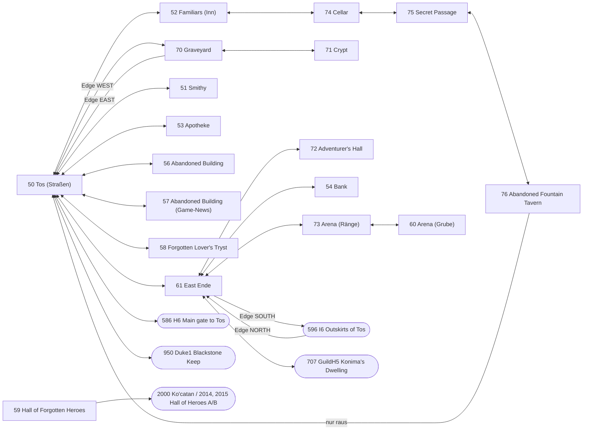

# Tos – Erfassung aus den KOD-Quellen

Quelle: Original-Blakod unter `kod/`. Maschinenlesbare Fassung: `game/server/data/world/tos.json`
(18 Räume, 91 Ausgänge, 31 verschlossene Türen, 3 Edge-Exits, 228 Objekte, 4 NPCs).
Alle Koordinaten sind KOD-Grid-Koordinaten (Zeile/Spalte, 1-basiert); Feinkoordinaten 0..63 innerhalb
eines Felds (`FINENESS = 64`, `kod/include/blakston.khd:1168`), Winkel 0..4095.

## 1. Räume

Alle Räume werden beim Serverstart in `kod/util/system.kod:2060-2078` angelegt (`CreateOneRoomIfNew`).
`TosRoom` ist eine leere Unterklasse von `Room` (`kod/object/active/holder/room/tosrm.kod:11`).

| RID | Konstante | Klasse (Basis) | Name | .roo | Musik | Licht | Flags (`viPermanent_flags`) | Quelle |
|----:|-----------|----------------|------|------|-------|------:|------------------------------|--------|
| 50 | RID_TOS | Tos (TosRoom) | The Streets of Tos | tos.roo | tos.mid | 209 | GUILD_PK_ONLY, LAMPS | `room/tosrm/tos.kod:11` |
| 51 | RID_TOS_SMITHY | TosSmithy | The Freelance Merchant and Menders Shop | tossmith.roo | smithy.mid | 100 | NO_COMBAT | `room/tosrm/tossmith.kod:11` |
| 52 | RID_TOS_INN | TosInn (ObjectRoom) | Familiars | tosinn.roo | bar.mid | 164 | NO_COMBAT, SANCTUARY, HOMETOWN, SAFELOGOFF | `room/monsroom/objroom/tosinn.kod:11` |
| 53 | RID_TOS_APOTH | TosApoth | Frisconar's Mysticals | tosapoth.roo | song02.mid | 164 | NO_COMBAT | `room/tosrm/tosapoth.kod:11` |
| 54 | RID_TOS_BANK | TosBank | First Royal Bank of Tos | tosbank.roo | bank.mid | 164 | NO_COMBAT | `room/tosrm/tosbank.kod:11` |
| 56 | RID_TOS_TAN | TosTan | Abandoned Building | tostan.roo | tos.mid | 164 | – | `room/tosrm/tostan.kod:11` |
| 57 | RID_TOS_GREY | TosGrey | Abandoned Building | tosgrey.roo | tos.mid | 164 | – | `room/tosrm/tosgrey.kod:11` |
| 58 | RID_TOS_FORGOTTEN (= RID_TOS_LOVERS) | TosForgottenLovers | Forgotten Lover's Tryst | tosforgt.roo | goodfor.mid | 164 | – | `room/tosrm/toslover.kod:11` |
| 59 | RID_TOS_FORGET | TosForgotten | Hall of the Forgotten Heroes | kochoh.roo | extra01.mid | 164 | – | `room/tosrm/tosforgt.kod:11` |
| 60 | RID_TOS_ARENA | TosArena | The Arena of Kraanan | tosarena.roo | pk_fm.mid | 164 | SAFE_DEATH | `room/tosrm/tosarena.kod:11` |
| 61 | RID_EAST_TOS (= RID_TOS_EAST) | EastTos | East Ende | easttos.roo | tos.mid | 164 | GUILD_PK_ONLY, LAMPS | `room/tosrm/easttos.kod:11` |
| 70 | RID_TOS_GRAVEYARD (= RID_TOS_GY) | TosGraveyard (MonsterRoom) | The Graveyard of Tos | tosgrave.roo | marion.mid | 124 | – | `room/monsroom/tosgrave.kod:11` |
| 71 | RID_TOS_CRYPT | TosCrypt (MonsterRoom) | The Crypt | toscrypt.roo | ksong.mid | 84 | – | `room/monsroom/toscrypt.kod:11` |
| 72 | RID_TOS_HALL | TosHall | The Adventurer's Hall of Tos | toshall.roo | main.mid | 164 | NO_COMBAT, SAFELOGOFF | `room/tosrm/toshall.kod:11` |
| 73 | RID_TOS_ARENA2 | TosArena2 | The Arena of Kraanan | tosaren2.roo | tos.mid | 164 | GUILD_PK_ONLY | `room/tosrm/tosaren2.kod:11` |
| 74 | RID_TOS_INN_CELLAR | TosInnCellar | The Cellar | toscellar.roo | bar.mid | 164 | NO_COMBAT | `room/tosrm/toscellar.kod:11` |
| 75 | RID_TOS_SECRET_PASSAGE | TosSecretPassage | Secret Passage | toshidden.roo | ksong.mid | 164 | – | `room/tosrm/toshidden.kod:11` |
| 76 | RID_TOS_OLD_TAVERN | TosTavern | Abandoned Fountain Tavern | tostavern.roo | tos.mid | 164 | – | `room/tosrm/tostavern.kod:11` |

(Pfade relativ zu `kod/object/active/holder/`.) RID 55 (`RID_TOS_ABANDONED`) ist definiert
(`kod/include/blakston.khd:414`), wird aber nirgends benutzt.

Hinweise:
- **Licht**: `piBaseLight` aufgelöst mit `LIGHT_VERY_DARK=84, LIGHT_DARK=124, LIGHT_NICE=164, LIGHT_MAX=255`
  (`blakston.khd:1111-1115`); Tos: `(LIGHT_MAX+LIGHT_NICE)/2 = 209` (`tos.kod:46`). Effektives Raumlicht:
  `piBaseLight + piOutside_factor*(SystemBrightness-50)/4`, geklemmt auf 0..255 (`room.kod:1417`).
  Default `piOutside_factor = OUTDOORS_COMPLETE (10)` (`room.kod:205`); gesetzt: Smithy 0, Inn 5, Bank/Apoth/Hall 3,
  Tan/Grey/Forgotten/Tavern 0, Graveyard 8, Arena 5.
- **outdoors** (JSON) ist eine Interpretation: `true` für Tos, East Tos, Arena (alle drei mit
  `piDirectional_percent = DIRECTIONAL_PERCENT_OUTDOORS` = Sonnenlicht), Friedhof (Windgeräusch, `OUTDOORS_8`)
  und Arena-Ränge (Arena2, Freiluft-Ring um die Arena). KOD kennt kein eigenes Outdoor-Flag.
- **Flags** (`blakston.khd:1034-1071`): SAFE_DEATH 0x1, NO_COMBAT 0x2, NO_PK 0x4, GUILD_PK_ONLY 0x8, NO_MAGIC 0x10,
  HOMETOWN 0x20, LAMPS 0x40, SANCTUARY 0x80, KILL_ZONE 0x200, GUEST_AREA 0x400, SAFELOGOFF 0x1000.
  `ROOM_LAMPS` schaltet die `Lamp`-Objekte nachts ein (`room.kod:3190`); Tos lässt außerdem die Licht-Sektoren
  1..17 außerhalb 11–17 Uhr flackern (`tos.kod:225-260`).
- **Teleport-Punkt** (`viTeleport_Row/Col`, für Admin-Teleport, Heimkehr ins Inn, Login-Fallback):
  `room.kod:785`. Arena2 hat keinen, überschreibt aber `Teleport` mit festem Ziel 26/30 (`tosaren2.kod:17-18,49`)
  – im JSON als `teleport` eingetragen. Arena: 22/13, `Teleport` dort wählt zufällig 22/13, 4/13 oder 13/4
  (`tosarena.kod:373`). TosForgotten setzt zusätzlich `viTeleport_Angle = ANGLE_NORTH` (`tosforgt.kod:241`).

## 2. Karte

Gegenrichtungen außerhalb Tos: `duke1.kod:62-63` (→ Tos 13/18), `monsroom/h6.kod:78` (→ Tos 58/4),
`monsroom/i6.kod:69` (Edge NORTH → East Tos 57/36), `ghall/guildh5.kod:99-100` (→ East Tos 1/41).
Tos-Yell-Zone: Graveyard, East Tos, Duke1, Old Tavern (`tos.kod:54-59`).

## 3. Ausgangs-Mechanik (aus `room.kod`)

### 3.1 Datenformat
- `plExits` (`room.kod:217-220`, gefüllt in `CreateStandardExits`, aufgerufen aus `Constructed`, `room.kod:295-300`):
  - Normaler Ausgang: `[row, col, RID, dest_row, dest_col, ROTATE_*]` (manche Räume außerhalb Tos hängen ein 7. Element
    `DISTANCE_NORMAL` an, z. B. `guildh5.kod:99`; wird von `SomethingTryGo` ignoriert).
  - Verschlossene Tür: `[row, col, ROOM_LOCKED_DOOR]` oder `[row, col, ROOM_LOCKED_DOOR, msg_rsc]`; `ROOM_LOCKED_DOOR = -1`
    (`blakston.khd:371`).
- `plEdge_Exits` (`room.kod:222-224`): `[LEAVE_*, RID, dest_row, dest_col, ROTATE_*]`, optional mit 7 Elementen
  `[..., bedingung, wert]` (ROW/COL_IS_GREATER/LESS_THAN, NO_OTHER_CONDITIONS; `blakston.khd:1217-1221`) – in Tos nicht benutzt.
- `Cons` hängt vorne an; die Liste ist also zur Laufzeit in umgekehrter Quellreihenfolge. Relevant nur bei
  doppelten Feldern (kommt in Tos nicht vor). JSON hält die Quellreihenfolge.

### 3.2 Normale Ausgänge / Türen – Auslösung
- **Nicht** durch Betreten des Felds. Auslöser ist ausschließlich die Aktion „Go/Open“ des Clients
  (Leertaste bzw. Befehl `open`, `module/merintr/merintr.c:255,439`): der Client schickt erst seine exakte Position
  (`MoveUpdatePosition`) und dann `BP_REQ_GO` ohne Parameter (`clientd3d/intrface.c:392-395`).
- Server: `BP_REQ_GO` → `UserGo` (`player/user.kod:1160-1172`, `5712-5744`). Bei `PFLAG_NO_MOVE` oder Blindheit:
  „You are unable to go anywhere.“ Sonst `room.SomethingTryGo(what, row=piRow, col=piCol, fine_row, fine_col)`.
- `SomethingTryGo` (`room.kod:2786-2858`): erster Eintrag in `plExits` mit `row == Spielerzeile && col == Spielerspalte`
  (nur Grid-Feld, Feinkoordinaten egal) gewinnt:
  - `ROOM_LOCKED_DOOR`: Nachricht `msg` (bzw. Default „This door is locked.“, `room.kod:27`) + Locked-Sound, Rückgabe TRUE, kein Raumwechsel.
  - Sonst (nur für User) `UserReqNewOwner(RID)` prüfen: verweigert nur Gildenhallen für Spieler ohne PK-Flag
    (`player.kod:11572-11594`). Danach Nachricht „You open the door and walk through.“ (`room.kod:46`), Türsound,
    neuer Winkel = `TranslateAngleChange(aktueller Winkel, ROTATE_*)` und
    `UtilGoNearSquare(what, Zielraum, dest_row, dest_col, new_angle)` – Feinposition immer Feldmitte 32/32.
  - Kein Treffer → `propagate`; Room-Basis liefert dann nichts → Client erhält „You are unable to go anywhere.“
- Spezialräume überschreiben `SomethingTryGo`: Arena2 sperrt Eingänge zur Arena, wenn die Arena per DM-Befehl
  `lock` verschlossen ist (`tosaren2.kod:109-125`); die Arena hat 4 zusätzliche **diagonale Türen mit Fein-Koordinaten-Bedingung**
  (`tosarena.kod:669-719`): Feld 20/6 mit fine_row>32 & fine_col>32 → Arena2 29/35; 19/5 mit <32 & <32 → 29/35;
  6/5 mit fine_row>32 & fine_col<32 → 22/35; 5/6 mit fine_row<32 & fine_col>32 → 22/35; Winkel bleibt erhalten.
  Diese stehen nicht im JSON.

### 3.3 `UtilGoNearSquare` (`kod/util.kod:20-107`)
Sucht ringförmig ab dem Zielfeld (Abstand 0, 1, 2, …) das erste Feld, auf das `UtilGoToSquare` setzen darf.
Für User beim Raumwechsel prüft `UtilGoToSquare` nur `ReqNewHold` (`util.kod:109-160`), d. h. Spieler landen praktisch
immer exakt auf dest_row/dest_col. Danach `NewHold` + `SomethingMoved` im Zielraum.

### 3.4 Rotation (`TranslateAngleChange`, `room.kod:2769-2784`)
`MAX_ANGLE = 4096`, `ANGLE_EAST=0, SOUTH=1024, WEST=2048, NORTH=3072` (im Uhrzeigersinn, `blakston.khd:1236-1245`).
- Wert ≥ `ROTATE_NONE (8)`: relativ, `neu = (alt + (wert-8)*512) mod 4096`.
  `ROTATE_NONE=8 (+0°)`, `ROTATE_45=9`, `_90=10`, `_135=11`, `_180=12`, `_225=13`, `_270=14`, `_315=15` (`blakston.khd:1258-1265`).
- Wert 0..7 (`SET_ANGLE_*`, `blakston.khd:1268-1275`): absolut, `neu = wert*512`.
- Kuriosum: East Tos → I6 nutzt als Rotation `ANGLE_SOUTH` (=1024, `easttos.kod:86`). 1024 ≥ 8 → `alt + 1016*512`
  = `alt + 127*4096` → effektiv **keine** Drehung. Im JSON steht `"rotate": "ANGLE_SOUTH"`.
- JSON-Feld `rotate`: Konstantenname ohne `ROTATE_`-Präfix (`"NONE"`, `"180"`), sonst Originalname.

### 3.5 Edge-Exits (Raumrand)
- Client sendet Bewegungen als `BP_REQ_MOVE` mit Fein-Gesamtkoordinaten; Server: `row = y/64`, `fine = y mod 64`
  (`player/user.kod:899-918`) → `UserMove` → `room.SomethingMoved` (`user.kod:3099`). Keine Server-Kollisionsprüfung für User.
- `SomethingMoved` (`room.kod:2222-2262`): ist `new_row > piRows` → `LEAVE_SOUTH`, `new_row < 1` → `LEAVE_NORTH`,
  `new_col > piCols` → `LEAVE_EAST`, `new_col < 1` → `LEAVE_WEST` (in dieser Prüfreihenfolge); `piRows/piCols` = Größe aus der .roo.
  Also sobald die gemeldete Position außerhalb des Grids liegt, nicht schon am Randfeld.
- `StandardLeaveDir` (`room.kod:2660-2767`): erster Eintrag in `plEdge_Exits` mit passendem `LEAVE_*` (5 Elemente → sofort).
  Monster werden nie über Kanten verschoben (Rückkehr ohne Aktion). User: `UserReqNewOwner`, dann
  `UtilGoNearSquare` auf dest_row/dest_col mit `TranslateAngleChange(alt, ROTATE_*)`. **Die Zielposition ist fest**
  (`pos` = Spalte/Zeile beim Verlassen wird übergeben, aber nicht genutzt). Kein passender Eintrag → nichts passiert
  (der Spieler „steht“ außerhalb; vgl. Kommentar `room.kod:2761-2765`).
- `LEAVE_SOUTH=1, LEAVE_NORTH=2, LEAVE_WEST=3, LEAVE_EAST=4` (`blakston.khd:1224-1231`).
- In Tos: Tos WEST → Graveyard 28/32; Graveyard EAST → Tos 50/3; East Tos SOUTH → I6 2/43.

## 4. NPCs, Objekte, Monster je Raum

NPC-Klassen liegen unter `kod/object/active/holder/nomoveon/battler/monster/towns/tostwn/` (Basis `TosTown is Towns`).

| Raum | NPC (Klasse) | Rolle | Position (row/col, fine, Winkel) |
|------|--------------|-------|----------------------------------|
| 52 Familiars | Paddock (`TosInnKeeper`, `TsInnK.kod:11`) | Wirt; verkauft Krug, Käse (`:95-98`); bedingt Purpurpilz ×4 (250), Orkzahn ×2 (650) | 7/9, 0/48, WEST (2048) – `tosinn.kod:101` |
| 53 Frisconar's Mysticals | Frisconar (`TosApothecary`, `TsApoth.kod:11`) | Apotheker; Fackel, Kräuter, Pilze, Holunder, Blau-/Rotpilz, Flasche; lehrt Spruch `SID_HOSPICE`; kauft Reagenzien; bedingt Solagh ×4 | 4/6, 10/32, SOUTH_WEST (1536) – `tosapoth.kod:211` |
| 54 First Royal Bank | Skivlat (`TosBanker`, `#bid=BID_TOS`, `TsBanker.kod:11`) | Bankier (`MOB_BANKER`; Befehle deposit/withdraw/balance laut Schild); verkauft/tauscht Edelsteine | 7/4, 32/32, EAST – `tosbank.kod:63` |
| 60 Arena | Watcher (`TosWatcher`, `tswatch.kod:11`) | Arena-Aufseher, Kampfrichter (CHAMPION/CHALLENGE/ACCEPT/RENEGE) | 13/20, 0/32, WEST – `tosarena.kod:213-214` |

- **Schmiede (51)**: kein NPC. `TosBlacksmith` („Fehr'loi Qan“) ist laut `TsSmith.kod:13` „no longer used“ und löscht
  sich selbst. Raum gibt +20 % Lernchance auf `Mend` (`tossmith.kod:94-104`).
- `TosUrchin`, `BasicInnKeeper`, `DukeGuard` sind TosTown-Klassen, werden aber in keinem Tos-Raum erzeugt.
- **Monster**: Graveyard `[Zombie 85 %, Skeleton 15 %]`, 8 Generatoren (`tosgrave.kod:51-54`);
  Crypt `[Zombie 80 %, Skeleton 20 %]`, 6 Generatoren (`toscrypt.kod:44-48`). Beide spawnen **nur nachts**
  (Stunde < 5 oder > 21, `tosgrave.kod:60-67`, `toscrypt.kod:53-64`). MonsterRoom-Defaults: Erstbefüllung 1–5,
  max. 10 Monster, Reload 180 s (`monsroom.kod:35-51`). Die Straßen selbst haben keine Monster.
- **Objekte** (JSON `objects[].type`): `OO_*` für `OrnamentalObject`, sonst KOD-Klassenname (`Lamp`, `Tree`
  (Tos-Ost: top OAK/bottom ELM), `Shrub`, `Fountain`, `Brazier`, `Table`, `BarStool`, `Sign`, `DynamicLight` (Farbe/Intensität
  nicht im JSON), `Candelabra`, `Tombstone`, `ArenaSign1/2`, `News`, `NewsAnnouncement`, `BookPedestal`).
  Defaults aus `NewHold` (`room.kod:1706-1708`): Winkel `ANGLE_EAST`, fine 32/32. Wo der Code `#angle=` statt
  `#new_angle=` übergibt (Smithy, Lovers, Cellar, Passage), wird der Parameter ignoriert → 0.
- Besondere Objekte: Brunnen auf dem Platz 56/18 (`tos.kod:219`, eigener Text/Licht `LIGHT_FOUNTAIN` nur in Tos,
  `kod/object/passive/fountain.kod:76,158`); Inn: Designers' News (`NID_ANNOUNCEMENTS`) und respawnende Krüge
  (`plObject_gen`, `tosinn.kod:55-66`); Tos Grey: Newsgroup „Game Discussion“ (`tosgrey.kod:72-78`);
  Adventurer's Hall: „General News“ (`toshall.kod:65-73`); Apotheke: Buch „The Legacy of Konima“; Bank: Schild.
  Friedhof: 11 Grabsteine; bei Spielertod im Friedhof bekommt ein Grabstein den Namen des Toten (`tosgrave.kod:93-109`).

## 5. Besonderheiten

- **Arena des Kraanan**: zwei Räume. 73 = Ränge/Ring (GUILD_PK_ONLY), Zugang aus East Tos an drei Stellen;
  60 = Kampfgrube (SAFE_DEATH: Tod ohne Verluste). Spielfeld 6..20 × 6..20 (`tosarena.kod:18-21`), Kampfstile
  (traditional, last man standing, guild vs guild, battle royale), DM-Befehle `booth`/`lock`, Labyrinth per Sektor-Anhebung.
- **Bank**: Bankkonto `BID_TOS`; das Schild nennt die Befehle deposit, withdraw (amount), balance.
- **Gilden**: Tos/East Tos sind `ROOM_GUILD_PK_ONLY` (Spielerkampf nur zwischen verfeindeten Gilden, `room.kod:1262,1278-1310`).
  Gildenhalle 5 „Konima's Abandoned Dwelling“ (RID 707) liegt nördlich von East Tos (Ausgang 1/41–42).
- **Versteckte Räume**: Inn-Keller (74) → Secret Passage (75) → Abandoned Fountain Tavern (76) → Tos 51/12.
  Die Taverne ist von der Straße aus verschlossen („The door to this tavern is locked.“, Tos 50/10, 50/11, 49/11).
- **Hall of the Forgotten Heroes (59)** liegt im Verzeichnis `tosrm`, nutzt aber `kochoh.roo` und führt nur nach
  Ko'catan (2000) bzw. Hall of Heroes A/B (2014/2015); erreichbar per Spruch Blink aus `RID_KOC_HALL_OF_HEROES`
  (`kod/object/passive/spell/blink.kod:66-70`). Statuen werden bei jedem ersten Betreten zufällig neu gesetzt (nicht im JSON).
- Mehrere Wohnhaustüren in Tos/East Tos sind reine Attrappen (ROOM_LOCKED_DOOR).

## 6. Start neuer Spieler im Original

- Neue Charaktere bekommen `piHomeroom = RID_NEWB1` (1011, „Raza Inn“, Insel Raza; `player/user.kod:7036-7040`).
- Verlassen von Raza über das Portal `NewbPortal` (`kod/object/active/portal/newbport.kod:55-100`, in `guest8/newb8.kod:58`):
  setzt eine **zufällige** Heimat Marion/Jasper/Cor Noth (`SetRandomHomeroom`, `user.kod:7043-7066`) – nicht Tos.
- Tos als Heimat: In der Universität von Cor Noth das Tos-Stichwort sagen → `SetHomeRoom(RID_TOS_INN, lock)`
  (`room/crnthrm/Coruniv.kod:452-485`). Das Inn ist `ROOM_HOMETOWN`; Teleportpunkt 7/8.
- Aus der Unterwelt (Tod) führt ein Portal ins Tos-Inn 8/7 (`room/monsroom/uworld.kod:649`).
- Landweg: Main gate H6 (586) → Tos 58/4; Blackstone Keep (950) → Tos 13/18; Outskirts I6 (596) → East Tos 57/36.
- Für unseren Server: `startRoom = 50` (Tos, Teleportpunkt 60/18) ist eine bewusste Abweichung vom Original.

## 7. Offene Fragen

1. `.roo`-Dateien (Geometrie, `piRows/piCols`) sind nicht im KOD; Raumgrößen für die Edge-Erkennung müssen aus den .roo
   gelesen werden.
2. Client-Koordinaten: `row = y/64` – ob der Client bereits 1-basiert sendet (Feld 1 = 64..127), muss am Client/Protokoll
   verifiziert werden.
3. Arena-Diagonaltüren (Fein-Koordinaten-Bedingungen) und Arena2-Sperre sind nur hier dokumentiert, nicht im JSON-Schema.
4. `outdoors` ist interpretiert (siehe §1); falls der Server das Licht nachbauen soll, wäre `outsideFactor`/`directionalPercent` nötig.
5. Exits nach außerhalb (H6, I6, Duke1, GuildH5, Ko'catan) zeigen auf noch nicht erfasste Räume.
6. TosHall setzt `prMusic = corhall_music` (Ressource aus `crnthrm/corhall.kod:22` = `main.mid`) – im JSON aufgelöst.
7. Raum 58 hat zwei Konstanten (RID_TOS_FORGOTTEN/RID_TOS_LOVERS), RID 59 heißt RID_TOS_FORGET, 55 ist ungenutzt.
8. Tos-Straße (50) Lockdoors 16/22, 17/22 haben keine eigene Nachricht → Default „This door is locked.“
9. Nachrichten enthalten Blakod-Formatcodes (`~k` = Farbe); Interpretation im neuen Client offen.
10. In `StandardLeaveDir` wird die Rotation über die Schleifenvariable nach `break` gelesen; bei 7-Element-Edge-Exits
    mit `NO_OTHER_CONDITIONS` ohne `break` könnte die Rotation eines falschen Eintrags genutzt werden (Original-Bug, in Tos irrelevant).
